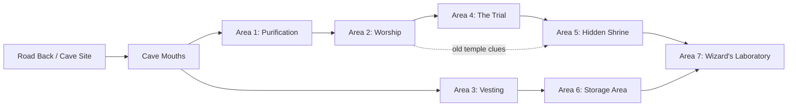

# 4e Solo Adventure - Narrative-Only Cut

This version keeps the adventure fiction, branching structure, clues, locations, and scenario ideas. It removes the original game's statistics, character sheets, monster mechanics, power cards, tactical rules, and image references.

Use the branches as prompts rather than rules. When an entry asks whether something succeeds, resolve it with your own system, decide based on the fiction, or choose the outcome that best fits the story you want.

## Solo Adventure: Goblin Attack

### 1

You are riding in a wagon beside Traevus, a dwarf merchant bound for Fallcrest. A cool breeze comes down from the Moon Hills. The wagon creaks along the old road, and Traevus is just beginning another story when a black-feathered arrow hisses from the hillside and strikes him.

He slumps sideways, blood spreading across his tunic. Harsh voices chatter from the rocks. Goblins swarm out of the brush, some scrambling toward the horses and wagon, one staying high on the slope with a bow.

- Draw a weapon and leap down into the fight: go to 2.
- Call on magic or a strange gift: go to 3.
- Slip from the wagon with a dagger and try to stay unseen: go to 4.
- Try to save Traevus first: go to 5.
- Hide in the wagon and hope the ambush passes: go to 6.
- Try a different idea: go to 42.

### 2

You pull a weapon free and drop from the wagon. The nearest goblin is already clawing at the wagon bed, hunting for plunder. It whirls toward you with a ragged blade and a mouth full of needle teeth.

If you strike first and press hard, go to 7. If you hesitate or the goblin slips around you, go to 9.

### 3

You draw on whatever power answers you: a whispered spell, a flash of will, an old charm, or a sudden force that gathers in your hand. The goblins pause for half a breath. They did not expect this.

- Turn your power on the clustered goblins near the wagon: go to 15.
- Strike at the archer on the hill: go to 16.
- Create a distraction or illusion to scatter them: go to 18.

### 4

You keep low, sliding from the wagon on the far side. The noise of the ambush covers your movement. A goblin has its back to you as it rummages through Traevus's goods.

If you get close before it notices you, go to 25. If it turns too soon, go to 27.

### 5

Traevus is still breathing, but the arrow wound is ugly. You crouch beside him while goblins shriek around the wagon. Whether by prayer, practiced fieldcraft, a charm, or sheer nerve, you try to keep the dwarf alive.

If your healing takes hold, go to 35. If you must abandon the attempt and defend yourself, go to 37.

### 6

You duck behind sacks and crates. For a moment the wagon boards hide you, but the goblins are here for plunder. They climb up, snuffling and laughing, and it is only a matter of moments before they find you or drag the wagon away with you inside it.

Return to 1 and choose a more active response, or accept capture and begin from 96.

### 7

You meet the goblin head-on. Your first blow drives it away from the wagon and forces it to fight you instead of stealing from Traevus.

If you bring it down quickly, go to 8. If it survives long enough to shriek for help, go to 11.

### 8

The goblin collapses in the road. Another darts in, slashing wildly, and the archer on the hill draws again.

If you avoid the worst of the counterattack, go to 12. If you are cut or grazed, go to 11.

### 9

The goblin twists aside and comes in low. Its blade flickers toward your leg while another goblin tries to climb onto the wagon.

If you recover and drive it back, go to 12. If the goblin's attack lands, go to 11.

### 10

The wagon horses panic and rear against the traces. Traevus groans. The fight is sliding out of control.

Choose quickly: defend the wagon in the open by going to 13, or retreat behind it and look for another angle by going to 4.

### 11

Pain flashes through you, but the wound is not the end of the fight. The goblins laugh too soon.

You set your feet and push back. Go to 13.

### 12

You slip out of reach and force the goblin to overextend. For one clear heartbeat, it is exposed.

Go to 13.

### 13

Your counterattack breaks the goblins' nerve. One falls, another stumbles away bleeding, and the archer on the hill lowers its bow. The remaining goblins grab what they can and scatter into the scrub.

Traevus is alive. The wagon is damaged, the road is churned with tracks, and the hills have gone quiet again.

Go to 45.

### 14

The magic gathers unevenly, bright and dangerous. The goblins do not understand what they are seeing, which may be your best advantage.

Choose whether to unleash it boldly at the group near the wagon by going to 15, or use it with precision against the archer by going to 16.

### 15

Cold, force, shadow, stone, flame, or some other power bursts among the goblins. The ones at the wagon shriek and tumble backward. The horses rear, but the goblins lose their hold.

The archer on the hill still has a clear shot. Go to 21.

### 16

You focus on the archer. It is higher than you and half-hidden among the rocks, but its next arrow could finish Traevus or put you down.

If your attack or working strikes true, go to 20. If it falters, misses, or merely startles the archer, go to 19.

### 17

The archer shifts position along the rocks, looking for a better line into the wagon. If you keep its attention on yourself, Traevus has a chance.

Go to 21.

### 18

You throw a false sound, a flash of impossible light, a conjured fear, or some other trick into the fight. The goblins hesitate, convinced for a moment that the ambush has turned against them.

If the trick sends them stumbling back, go to 24. If it only buys a moment, go to 21.

### 19

The archer flinches but does not fall. It answers with a hissed curse and a black-feathered arrow.

Go to 21.

### 20

Your strike slams into the archer. It drops from view behind the rocks, and the goblins below cry out in alarm.

Go to 24.

### 21

An arrow cuts through the air from the hillside.

If it strikes you or forces you into cover, go to 22. If it misses or buries itself harmlessly in the wagon, go to 23.

### 22

The arrow bites, but the wound is not deep enough to stop you. The goblins have seen that your power can hurt them, and fear begins to outrun their greed.

Go to 24.

### 23

The arrow misses. The archer has lost the rhythm of the ambush, and the goblins at the wagon are looking over their shoulders for a way out.

Go to 24.

### 24

Your display breaks the attack. The goblins scatter, dragging their wounded with them and leaving the road suddenly empty.

Traevus is alive, though shaken. The wagon is damaged. Something has been stolen.

Go to 45.

### 25

You move like a shadow along the wagon's side. The nearest goblin is too busy pawing through a chest to notice you.

If you strike before it turns, go to 26. If it hears you at the last moment, go to 27.

### 26

Your dagger finds its mark. The goblin drops with a startled squeal, and another goblin spins toward you.

Go to 28.

### 27

The goblin sees you and jerks aside. Your first cut does not end the fight. It bares its teeth and lunges.

Go to 28.

### 28

The goblin's blade flashes in the cramped space beside the wagon.

If you are wounded, go to 29. If you slip away cleanly, go to 30.

### 29

The cut burns, but the goblin has exposed itself. Its confidence is bigger than its courage.

Go to 30.

### 30

You need to turn this into more than a knife fight beside a wagon.

- Use a shove, trip, feint, or sudden rush to break the goblins' formation: go to 31.
- Use quick footwork, misdirection, or a defensive flourish to make them doubt the fight: go to 32.

### 31

You crash through the goblin's guard and send it stumbling into another attacker. The ambush becomes confused: goblins trip, shout, and lose track of who is winning.

Go to 33.

### 32

You twist away from one blade and put your dagger where the next goblin least expects it. You are no longer prey in their minds.

Go to 34.

### 33

The goblins decide this wagon is too costly. One drops its stolen bundle, another spits a curse, and then they bolt for the hills.

Go to 45.

### 34

A final sharp flourish convinces the goblins that the ambush has failed. They scatter into the scrub before you can catch them all.

Go to 45.

### 35

Traevus gasps as the worst of the wound closes or the bleeding slows. His eyes focus on you with startled gratitude.

Then a goblin jumps onto the wagon and raises its blade. Go to 37.

### 36

You take a hit while protecting Traevus, but he lives because you chose him first. That matters.

Go to 37.

### 37

You rise between Traevus and the goblins. Whether your power is divine, herbal, oath-bound, or simply fierce compassion, it gives you something to stand on.

- Drive the goblins back with radiant protection, stern command, or a blazing sign: go to 38.
- Answer them with thunder, fury, or a brutal counterblow: go to 41.

### 38

Light, authority, or an aura of refusal gathers around you. The goblin nearest Traevus falters.

If you strike it down, go to 39. If your blow misses but your presence holds, go to 40.

### 39

The goblin falls. The others see Traevus stirring behind you and realize their quick raid has failed.

Go to 45.

### 40

Your attack does not land cleanly, but the goblins believe the road has turned against them. Fear does what steel did not.

They run. Go to 45.

### 41

You answer the ambush with force. A goblin rushing the wagon is met by thunder, a hard weapon blow, a curse, or a sudden surge of wrath.

If the counterattack breaks it, go to 43. If it survives but loses heart, go to 40.

### 42

You try something unexpected: cutting the horses free, overturning cargo, bluffing that soldiers are nearby, setting a small fire, throwing food as bait, or using the landscape against the ambushers.

If the idea plausibly breaks the goblins' courage or momentum, go to 45. If it only delays them, return to 1 and choose how you follow through. If it goes badly, go to 44.

### 43

Your counterblow lands with enough force to make the whole ambush recoil. The goblins break apart and flee toward the hills.

Go to 45.

### 44

The fight goes wrong. A blade, arrow, or unlucky fall drops you beside the wagon. The last thing you hear is goblin laughter and Traevus groaning your name.

Go to 96.

## Part 2: Tracking the Goblins

### 45

As the last goblins vanish, you glimpse a rider on a distant hill: a human figure in a red cloak on a black horse. The rider watches the failed ambush, shakes a fist in anger, and gallops southwest into the Moon Hills.

Traevus searches the wagon with rising panic. A small locked wooden box is gone. He says the box is personal, important, and not meant for thieves. He offers a reward if you recover it and discover who sent the goblins.

- Volunteer to help at once: go to 46.
- Ask Traevus what the job is worth: go to 47.
- Promise to bring the attackers to justice: go to 48.
- Refuse or try to leave the matter behind: go to 49.

### 46

Traevus grips your arm. Gratitude and fear fight across his face. He cannot pursue the thieves himself, but he can tell you where the goblins fled and what he saw of the rider.

Go to 60.

### 47

Traevus offers coin for the box's return, but his anxiety suggests the box matters far more than money. He will not explain its contents, only that it must not remain in the hands of whoever ordered the attack.

Go to 60.

### 48

Traevus nods at the word justice, though something in his expression remains guarded. The goblins were tools. The rider is the deeper problem.

Go to 60.

### 49

If you leave now, the mystery vanishes into the Moon Hills: the red-cloaked rider, the stolen box, and whatever made Traevus so afraid.

If you reconsider, go to 60. If you walk away, this thread ends here, unresolved.

### 50

You take a few minutes to search the road. The ambush site is a mess of hoofprints, wagon ruts, blood, and goblin tracks.

Go to 60.

### 51

The choice is yours. Help for reward, for justice, out of curiosity, from loyalty to Traevus, or because the rider's anger makes the whole affair feel larger than a roadside theft.

Go to 60.

### 52

Traevus cannot offer much more than coin and gratitude. He is wounded, frightened, and trying not to say what the box contains.

Accept the hook by going to 60, or leave the mystery by going to 49.

### 53

Traevus watches you go with a look that may be disappointment, fear, or calculation. Behind you, the Moon Hills swallow the trail.

This is an ending, but not a resolution.

### 54

Before you leave the wagon, Traevus gives you the clearest description he can: a red cloak, a black horse, a human rider, and a route southwest into rougher country.

Go to 60.

### 55

The goblins were not merely raiding. They knew what they wanted. Someone sent them for the box.

Go to 60.

### 56

You gather what supplies you can spare, steady the horses, and mark the direction of the fleeing goblins.

Go to 60.

### 57

The Moon Hills rise ahead in stony folds. Ravines, scrub, and old cave mouths make the country easy to hide in and hard to search.

Go to 60.

### 58

A wounded goblin groans among the roadside weeds. It is not dead yet.

If you question it, go to 74. If you ignore it and follow the tracks, go to 60.

### 59

The road behind you leads to Fallcrest and safety. The hills ahead lead to answers.

Go to 60.

### 60

Choose your approach.

- Follow the red-cloaked rider's path: go to 61.
- Track the goblins who fled with the box: go to 68.
- Question a surviving goblin: go to 74.
- Abandon the search and seek help in Fallcrest: go to 95.

### 61

You climb toward the hill where the rider appeared. The view opens over scrubland and broken ravines. The rider is gone, but the land may still remember him.

If you find signs of the horse, go to 64. If the trail vanishes, go to 63.

### 62

A faint trail cuts down into a valley between the rocks. It is narrow, half-hidden, and marked by recent passage.

Go to 66.

### 63

The rider has too much of a head start. Wind and stone erase the trail.

Return to 60 and choose another approach.

### 64

You search for hoofprints, broken stems, and disturbed stones.

If you find a clean sign, go to 66. If the ground defeats you, go to 65.

### 65

The horse's tracks disappear among stone and dry grass. The rider knew this country or had a destination already chosen.

Return to 60.

### 66

You find the horse's trail. It bends toward a cluster of cave mouths hidden among the hills. Smaller goblin tracks cross and recross the same ground.

If you approach carefully, go to 83. If you rush or make too much noise, go to 67.

### 67

A shout echoes from the rocks. Goblins at the cave mouth have seen you coming.

Go to 83, but the lair is alert.

### 68

The goblins left a more chaotic trail than the rider: small footprints, dragged bundles, and places where they argued or regrouped.

If you can follow the main trail, go to 69. If the tracks scatter, go to 72.

### 69

The trail leads off the road, through scrub and broken stone, then up into the Moon Hills. The goblins were moving fast, but not carefully.

If you handle the rough country well, go to 70. If the terrain slows or exposes you, go to 71.

### 70

You reach the caves without warning the guards. Smoke rises from a small camp near the entrance.

Go to 83.

### 71

You reach the caves tired, scratched, or too visible. The goblins may have heard you coming.

Go to 83.

### 72

The tracks split across a stony patch. For a time the trail seems lost.

If you can think like fleeing raiders and find their regrouping point, go to 73. Otherwise, return to 60.

### 73

You spot the place where the goblins gathered after the ambush: crushed grass, spat curses, and a scrap of cloth from the wagon. From there the trail is clear again.

Go to 69.

### 74

You kneel by the dying goblin. Its breath rattles. It watches you with terror, hatred, and a thin hope that it might yet live.

If you stabilize or calm it enough to speak, go to 75. If it dies before answering, return to 60.

### 75

The goblin wakes, flinching from your shadow.

- Calm it and offer mercy: go to 76.
- Threaten it with the consequences of silence: go to 81.
- Let it live without questions and continue the search: go to 60.

### 76

The goblin expects cruelty. Mercy confuses it.

On a strong success, go to 77. On a partial success, go to 78. If it is too frightened or injured to say much, go to 79. If it refuses or fades, go to 80.

### 77

The goblin spills the story in broken fragments. The raid was ordered by Kurrash, a bugbear who leads the local goblins. Kurrash serves a human wizard named Malareth. Malareth was the rider in the red cloak. He lives in an ancient buried temple hidden among the caves to the southwest.

The goblins were told to steal Traevus's small box. The goblin does not know what is inside, only that Malareth wanted it badly.

Go to 83.

### 78

You get the heart of the matter: a human wizard named Malareth sent the goblins, and he keeps a lair in old temple ruins hidden inside the caves. The red-cloaked rider was almost certainly him.

Go to 83.

### 79

The goblin gives directions more than answers: caves to the southwest, goblin guards, Kurrash the bugbear, and a human master inside.

Go to 83.

### 80

The goblin dies or shuts down before you can learn anything useful. The road is quiet again, and the hills wait.

Return to 60.

### 81

Fear can loosen a tongue, but it can also turn words into noise.

If the goblin breaks and talks, go to 77. If it gives only directions, go to 79. If panic overwhelms it, go to 82.

### 82

The goblin thrashes, babbles, and nearly chokes on its own terror. It may know more, but not in any form you can use.

Choose mercy and return to 60, or leave it to the hills and follow the most likely trail to 83.

### 83

You find the goblin lair: cave mouths cut into the hillside, smoke from low fires, rough voices, and the stink of animals and old blood. Somewhere inside are Kurrash, Malareth, and Traevus's stolen box.

If you arrived quietly, the guards are distracted and scattered. If the lair is alert, goblins gather at the entrances with weapons ready.

- Defeat or evade the outer guards, then withdraw to seek allies: go to 94.
- Decide the lair is too much and retreat before the fight turns ugly: go to 95.
- Fall in battle or get captured: go to 96.

### 84

Smoke drifts from a cave entrance and carries the smell of damp stone, cooked meat, and goblin filth.

Go to 83.

### 85

You see at least one deeper passage beyond the guards. The goblin lair is only the doorway to something older.

Go to 83.

### 86

The red-cloaked rider's tracks pass the outer caves and vanish into the same darkness as the goblin trail.

Go to 83.

### 87

A black horse may have stood near the caves recently: cropped grass, deep hoofprints, and a scuffed patch of stone mark the place.

Go to 83.

### 88

If you listen long enough, you hear goblins arguing about Kurrash, the box, and whether their human master will be pleased.

Go to 83.

### 89

The outer camp is poorly disciplined. That makes it vulnerable, but it also means any fight could become loud and chaotic.

Go to 83.

### 90

The caves feel too old for goblins. Worked stone shows beyond the natural rock, as if the hill has swallowed a building.

Go to 83.

### 91

You have enough clues to know the ambush was part of a larger design. The next step is not just revenge. It is descent.

Go to 97.

### 92

If you bring companions back here, the cave mouths will be the beginning of a larger adventure.

Go to 97.

### 93

The goblins at the entrance sit near a fire, passing stolen food and arguing. Behind them, the cave slopes down into old worked stone.

Go to 83.

### 94

You win a small victory at the cave mouth, but the deeper lair is too dangerous to clear alone. You have found the place. Now you need allies, a plan, and answers.

Go to 97.

### 95

You withdraw to Fallcrest. The retreat stings, but it is not failure. You know where the trail leads, and the mystery has grown too large for one traveler.

Go to 97.

### 96

You wake in the Nentir Inn, sore and confused. Someone found you after the ambush or near the caves, paid for your room, and left instructions that you be cared for. The rescuer is gone.

Traevus's box is still missing. The red-cloaked rider is still somewhere in the hills.

Go to 97.

### 97

The solo adventure ends with the mystery open. A merchant's stolen box, a red-cloaked rider, a goblin band, a bugbear named Kurrash, and a necromancer named Malareth all point toward the buried temple in the Moon Hills.

The next chapter begins when you return to the caves.

## Mini-Adventure: The Road Back

After the solo episode, the hero returns with allies or renewed resolve. The goblin caves are still there, but the road back is not empty.

### Roadside Ambush

On the lonely road near the cave site, rocks crowd close to one side and a ruined tower leans above the brush on the other. Wolves slip from the stones first, lean and hungry, trying to drive travelers toward the ruin. Then goblins appear from broken masonry and rush the road.

This is a reminder that Malareth's servants are active outside the dungeon. The ambush can be run as a fast scene of danger, pursuit, and hard choices rather than a formal battle. The wolves are predators trained or encouraged by goblins; the goblins are opportunists hoping to weaken intruders before they reach the caves.

Useful story details:

- The ruined tower suggests older settlement in the Moon Hills.
- The goblins may carry scraps from Traevus's wagon or gossip about Kurrash.
- A captured goblin can confirm that the red-cloaked human has entered the buried temple.
- The black horse may have been seen near the caves, restless and ill-treated.

## Mini-Adventure: The Twisting Halls

The cave mouths lead into a buried temple complex known as the Twisting Halls. The place is older than the goblin lair and more dangerous than a bandit cave.

### Background

Long ago, a noble community of minotaurs built a temple in the Moon Hills. Publicly, it honored four gods associated with justice, civilization, craft, and the sun. Secretly, some of the temple's priests made a hidden shrine to the Horned King, a brutal demon patron of savagery and labyrinths.

The corruption spread. The gods cursed the temple, the priests turned against one another, and the complex was abandoned and eventually buried. Monsters later found their way into the ruins, drawn by lingering malice and old power.

Malareth discovered the place and made it his base. He enslaved or hired goblins, set Kurrash the bugbear over them, and built a laboratory for necromancy in the temple's depths. The stolen box from Traevus now lies somewhere inside.

### Main Threads

The adventure has two central threads:

- Find out who the red-cloaked rider is.
- Recover Traevus's stolen box.

A third thread grows from the ruins themselves: discover what happened to the minotaur temple and what evil still clings to it.

### Entering the Halls

The outer caves show signs of goblin occupation: smoke, refuse, crude bedding, and stolen goods. Deeper in, the natural cave gives way to cut stone. The air cools. Symbols of old gods appear under grime. The dungeon is not merely occupied; it is haunted by history.

Two main passages lead inward. One descends toward old ritual chambers. Another bends toward rougher living spaces and guard rooms. Either route can eventually reveal Malareth's laboratory.

## Map as Node-Edge Graph: The Twisting Halls

The original poster-map advice deliberately supports rearranging chambers, so
this graph treats the dungeon as functional story flow rather than fixed
geometry. It preserves the two-route entry, the public temple, the hidden cult
thread, and the final laboratory.

### Edge List

- Road Back / Cave Site -> Cave Mouths.
- Cave Mouths -> Area 1: Purification.
- Cave Mouths -> Area 3: Vesting.
- Area 1: Purification -> Area 2: Worship.
- Area 2: Worship -> Area 4: The Trial.
- Area 4: The Trial -> Area 5: Hidden Shrine.
- Area 3: Vesting -> Area 6: Storage Area.
- Area 5: Hidden Shrine -> Area 7: Wizard's Laboratory.
- Area 6: Storage Area -> Area 7: Wizard's Laboratory.
- Area 2: Worship -. old temple clues .-> Area 5: Hidden Shrine.

## Keyed Locations

### Area 1: Purification

This chamber once prepared worshippers for holy rites. It now serves as a guard post.

A cloudy ritual pool stands in one side of the room. Smaller basins hold unexpectedly pure water. Nearby, braziers burn with scented smoke and red light. A set of beaten-brass doors leads deeper into the temple. Malareth's black horse may be tethered here, sweating and anxious, as if it hates the place.

Current occupants include goblin guards and a reptilian guard beast. One goblin may be a shaman or hex-caster who understands that the room is old but not what it was for.

Story elements to use:

- The cloudy pool can show brief, distorted visions of other rooms: altars, a chessboard floor, a horned statue, or Malareth bent over an open box.
- The clean basins contrast with the corruption elsewhere. Their water may calm fear, wash away grime, or reveal hidden symbols.
- The fire chamber and red-glass glyphs suggest a purification ritual now reduced to eerie decoration.
- If freed, the black horse may flee the dungeon or later identify Malareth by association.

Behind a brazier, the goblins have hidden a small sack of stolen coin.

### Area 2: Worship

This was the public heart of the temple: a hall of four altars. Time, monsters, and cold have made it hostile.

A fledgling white dragon named Farallax has claimed part of the area as a lair. Kobolds or other small servants may skulk nearby. Curtains, rubble, and the shape of the room make it easy for the dragon to hide until it wishes to be seen.

The four altars remain:

- An altar of justice, marked by a winged figure and a dragon-headed symbol.
- An altar of craft, with a mural of a powerful minotaur carving mountains.
- An altar of civilization, with a basin of clear water and a female minotaur bearing spear and shield.
- An altar of the sun, cracked and dry before the statue of an elderly minotaur.

Runes near the altars point to ideals such as civilization, justice, creation, war, hope, life, sun, and time. A magic circle or ritual mark can show a vision of the temple at its height: gold-lit halls, ceremonial music, and treasure somewhere farther west.

#### Farallax

Farallax is proud, young, greedy, and vain. The dragon is not truly Malareth's servant. It enjoys flattery but resents the necromancer's presence and knows the goblins are poor neighbors.

Possible ways to deal with Farallax:

- Flatter its power and beauty.
- Offer treasure or future tribute.
- Promise to remove Malareth and the goblins from the dragon's halls.
- Admit that fighting a dragon is not why you came.

If Farallax is persuaded, it may allow passage or demand a promise. If offended, it attacks or blocks the route. Its hoard contains coin, turquoise, and a piece of enchanted leather armor or another useful treasure appropriate to your system.

### Area 3: Vesting

These chambers were once private rooms where minotaur priests dressed for ceremonies. Ancient furniture has collapsed into rot and dust. A large statue of a minotaur champion still stands, stern and half-shadowed.

Now the rooms are used by goblins and vermin. Enormous rats nest among the debris. Goblin lookouts use the broken rooms as cover. In one hall, a newer carpet lies suspiciously across the floor, too clean and too carefully placed for the rest of the ruin.

Story elements to use:

- The carpet conceals a pit or other trap. Anyone who notices the floor around it looks wrong can avoid the danger or turn it against the goblins.
- The rats are not just monsters; they show how thoroughly the sacred rooms have decayed.
- The goblins may be laughing as a rat chews the carpet, unaware that they are spoiling their own trap.

On the back of the champion statue is a scratched message in an old dwarven script:

> Seven days have passed and I am the only one who remains. I fear I will never escape to bring word of this place to my clan, to warn them of the danger. Something has driven Morgana mad, and I despair of ever learning what it was. You who find this must warn-

The message ends abruptly. It is a clue to the temple's fall and a seed for later adventures.

### Area 4: The Trial

This chamber guards the route to the hidden shrine. The floor is laid out in alternating light and dark squares like a great game board. Statues stand along the edges: soldiers, a queen, a mounted knight, and an elephant bearing a siege tower.

The room is a test of movement and discipline. Once intruders step onto the board, the chamber expects them to move according to the logic of chess pieces. The first square or figure they choose can determine how they are allowed to cross. Wrong movement awakens the statues or sends a psychic backlash through the room.

Use this as a puzzle scene rather than a rule exercise. The important beats are:

- The board is beautiful, ancient, and dangerous.
- The statues animate if the trial is disrespected or misunderstood.
- Observant characters can infer the movement pattern from the statues.
- Reaching the far side allows passage to the hidden shrine.
- If everyone leaves, the surviving statues return to their places and the room resets.

### Area 5: The Hidden Shrine

Behind the public temple lies the secret rot: a shrine to the Horned King. The air is heavy, sour, and wrong. Candles burn with a blood-red glow. A hulking minotaur statue in an iron crown looms over a jagged altar. A female minotaur priest statue smiles with unnerving cruelty.

Malareth's human guards occupy the room, but one of them is not what he seems. Jixin, a doppelganger mercenary, has joined Malareth for pay rather than loyalty.

Story elements to use:

- The altar and horned statue radiate old savagery, ambition, and madness.
- The minotaur statue's moonstone eyes are valuable and may carry a curse, memory, or temptation.
- The shrine explains why the temple fell: the public holiness was compromised from within.
- Jixin may betray the other guards if the fight turns against them.

#### Jixin

Jixin is sarcastic, pragmatic, and very interested in surviving. If threatened, he may drop his weapon, offer a potion or secret, and bargain for safe passage.

What Jixin can reveal:

- Malareth is the red-cloaked rider.
- Malareth is a necromancer.
- Malareth and Traevus once knew each other in Fallcrest.
- Their relationship ended bitterly.
- Malareth sent the goblins to steal something from Traevus.
- The laboratory lies farther on, past the shrine and deeper into the old complex.

Letting Jixin live creates an excellent recurring contact: unreliable, amused, and possibly useful.

### Area 6: Storage Area

Old storage rooms have become the den of Kurrash, the bugbear who leads the goblin band for Malareth. The rooms smell of mold, sweat, old crates, and smoke. Rope, rations, chains, lamp oil, candles, and stolen supplies are stacked or scattered throughout.

Kurrash is huge, brutal, and practical. He serves Malareth because it profits him, not because he loves the necromancer. If Malareth is already dead or clearly losing, Kurrash may be bullied, bribed, or frightened into fleeing. If cornered, he fights with desperate violence and may overturn a fiery urn or ignite lamp oil to cover his escape.

Story elements to use:

- Kurrash knows the goblins were ordered to steal Traevus's box.
- He resents Malareth's arrogance but fears his magic.
- His stores include practical supplies that can help future travel.
- His weapon may be a grim enchanted greataxe or simply a trophy of his cruelty.

### Area 7: Wizard's Laboratory

The deepest chamber is Malareth's laboratory. The air stinks of death, chemicals, and hot metal. Glass vessels bubble on tables. Bones, powders, old books, and blood-labeled vials are arranged with obsessive care.

An ogre corpse has been raised as a hulking undead servant. Skeletons wait near the walls. Malareth, a gaunt human in robes marked by skull motifs, works at the central table. He is the red-cloaked rider.

He is dismissive at first, treating intruders as an insult rather than a threat. Possible taunts:

- "That fool Traevus sent you, didn't he?"
- "Are you supposed to be heroes? Give up. You are out of your depth."
- "My lord Orcus will feast on your souls."

Orcus, in this context, is a demon lord of undeath. Malareth's true allegiance is not to the old minotaur cult but to necromantic power.

Story elements to use:

- Vials are labeled with ingredients such as human blood, vampire blood, wraith ichor, dragon bone powder, and amaranth.
- A side table holds notes, half-finished formulae, and clues to other necromantic interests.
- Bookshelves contain dangerous texts and possible future adventure hooks.
- The stolen box lies open on the central table.
- Malareth has been studying the box's contents with intense fascination.

Once one of his undead servants falls, Malareth's contempt turns to fury. He promises that the intruders will replace the undead they destroyed.

## Conclusion

When Malareth is defeated or driven off, the box can be recovered. It is small, locked, and lined with black velvet. Inside rests a human skull infused with necromantic magic.

This discovery makes Traevus more complicated. Why was a dwarf merchant carrying such a thing? Was he transporting it to be destroyed, hiding it from Malareth, selling it, or serving some darker purpose of his own?

If the box is returned, Traevus pays the promised reward. If confronted about the skull, he claims he was taking it to a mountain temple in the Cairngorm Peaks, where holy monks could destroy it or keep it safe.

Whether Traevus is telling the truth is a powerful next hook:

- He may be sincere, and the next adventure is an escort journey to the mountains.
- He may be frightened and only partly honest, trying to protect others from a truth he barely understands.
- He may be lying, using the heroes to recover a necromantic relic for his own patron.
- Malareth may have been only one of several people hunting the skull.

The adventure ends with the immediate threat broken, but the skull remains. It is an object with history, enemies, and a future.
