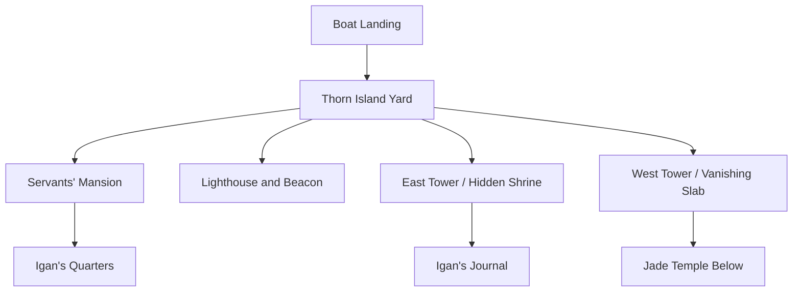
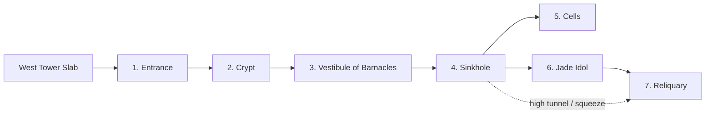

# Secrets of Sokol Keep - Narrative-Only S&S Cut

This version keeps the adventure fiction, investigation structure, named
characters, clue chain, locations, haunted keep, island approach, temple rooms,
and scenario outcomes. It removes the original game's organized-play
instructions, character-level assumptions, stat blocks, encounter adjustments,
XP, reward math, tactical rules, maps-as-images, and system-specific checks.

Use this module as a Candlelight Dungeons adventure seed for Sinew & Steel.
Resolve uncertainty through S&S: intent and method first, then a roll only when
the outcome matters. Treat locks, traps, social pressure, undead, animated
armor, and the murderers below the keep as fiction-forward dangers rather than
imported D&D mechanics.

## Adventure at a Glance

- **Starting point:** The Laughing Goblin, a rough dockside tavern in Phlan.
- **Central problem:** The beacon atop Sokol Keep has gone dark and the keep's
  small garrison has vanished.
- **Visible stakes:** Phlan's harbor trade and coastal defense depend on the
  beacon. The docks are already anxious, angry, and ready to blame someone.
- **Hidden truth:** Igan Sokol found an ancient temple below the keep with help
  from the spirit Harae and Guard Sergeant Grim. When Igan judged the treasure
  evil and wanted it destroyed, Grim murdered him. The killing woke the temple's
  dead guardians and trapped Grim with his surviving conspirators below.
- **Haunting:** Harae, a dead priestess of Tyr bound to the forgotten shrine in
  the East Tower, extinguished the lighthouse beacon to draw help to the island.
- **Resolution:** Recover Igan's body, uncover the truth, decide Grim's fate,
  and satisfy Harae enough for the beacon to burn again.

## Core Themes

- Public order fraying into rumor and blame.
- A noble house's neglected duty.
- A lawkeeper spirit whose demand for justice has become a haunting.
- Treasure that is real, old, and morally dangerous.
- Soldiers trapped by their own greed.
- The difference between punishment, vengeance, and justice.

## Background

Thorn Island sits in the Bay of Phlan as a natural breakwater. Sokol Keep,
standing on the island, is old enough that the stories about it contradict one
another. Some say it was once a temple. Some say dead priests haunt its cellars.
Some say there is treasure below.

House Sokol restored and expanded the keep after taking control of the island.
The house never admitted to finding treasure and had little patience for
intruders searching its property. Recently, trouble in Phlan drew most of House
Sokol away, leaving only a small household staff, a junior house member named
Igan Sokol, and a Black Fist detachment to maintain the beacon and keep the
place secure.

Igan knew his assignment was a kind of exile. Hoping to restore his standing,
he began searching for the old treasure. He had one advantage earlier hunters
lacked: as a child, he had found a hidden shrine of Tyr in the East Tower. The
shrine was haunted by Harae, a weak but watchful spirit of a long-dead priestess
of Tyr. Harae liked Igan's devotion and guided him by moving books and objects.

Guard Sergeant Grim Thornbuck learned of Igan's search and encouraged him. With
Grim and the other Black Fist guards helping, Igan found the hidden caverns
beneath the West Tower and the treasure inside. When Igan saw the Jade Idol and
judged it evil, he wanted the thing destroyed. Grim wanted the wealth. Greed
won. Grim stabbed Igan at the altar.

The murder woke the temple's dormant guardians. Grim and his surviving
conspirators fled deeper into the temple, trapped in the dark with stolen
trinkets, muddy water, dwindling nerve, and no safe path out. Harae, furious
and grieving, extinguished the beacon so that someone would come to the island,
recover Igan's body, and bring his killers to justice.

## Adventure Structure

1. **The Laughing Goblin:** Gather rumors, meet dockside NPCs, and navigate a
   tavern brawl that reveals the social pressure around the darkened beacon.
2. **Permission and Passage:** Speak to House Sokol, the Black Fist, or both,
   then reach Thorn Island by ferry, boat, or dangerous self-reliance.
3. **Sokol Keep:** Question the servants, sense the haunting, search Igan's
   quarters, the lighthouse, the East Tower shrine, and the West Tower slab.
4. **The Jade Temple:** Descend into the wet under-temple, survive its awakened
   guardians, find Igan's body, confront Grim, and decide what justice means.
5. **Conclusion:** Harae's curse lifts only if the truth is honored or justice
   is served in a way she can accept.

## Act I: The Laughing Goblin

The adventure begins at the Laughing Goblin, a famous but battered tavern near
the docks of Phlan. It caters to sailors, mariners, mercenaries, dockworkers,
and people with more stories than money.

The beacon at Sokol Keep went out two days ago. Everyone at the docks has an
opinion. House Sokol and the Black Fist are blaming each other, ships are
delayed, and rumors of ghost ships on the Moonsea make the dark lighthouse feel
like more than an inconvenience.

### The Tavern

The Laughing Goblin is large, old, and dark. Its woodwork is worn, its plaster
has yellowed, its lanterns and chandeliers are rusted, and its furniture bears
the scars of many brawls.

The common room has two floors around a large open space. A bar, a stage, and a
fireplace dominate the room. Booths line the walls. The only real decoration is
a large carved totem of a laughing goblin, very old and worn smooth by years of
hands and smoke.

The smell of cabbage soup drifts out of the kitchen. There are not many guests
at this hour, but the tavern is far from empty.

### Imizael

Imizael tends the bar. She is a thin human woman with long black hair and a
name that sounds elven because her mother was fascinated by elves. She is busy,
curt, attentive, and practical. She keeps an eye on the room and directs
gossip-hungry patrons toward Markoth, whom she calls Fat Mar and insists should
keep his nose out of other people's business.

Imizael wants the tavern orderly enough to keep earning. She dislikes the
coming brawl before it even begins.

### Markoth Hasselpond, Called Fat Mar

Markoth works the floor. He is rotund, sweating, sharp-tongued, foul-mouthed,
and quick to warm up when someone asks for his real name instead of his
nickname.

He loves gossip and tall tales. Over soup, ale, or a friendly conversation, he
can share:

- The beacon at Sokol Keep went out two days ago.
- Sokol Keep is very old and may be as old as Phlan itself.
- Stories say the keep was once a temple and that dead priests haunt buried
  treasure below it.
- House Sokol owns the keep, but the family is relatively new nobility.
- House Sokol keeps the lighthouse because it still brings income and matters
  to trade.
- Only a few retainers and Black Fist guards still work there.
- If rumors of spirit ships and monstrous pirates are true, Sokol Keep is
  Phlan's first line of defense.
- Two mercenaries in the corner, Keria and Aravele, may know more because they
  were friends with missing Black Fist guards stationed at the lighthouse.

### Other Guests

- **Ortal Gruk:** A half-orc nursing a drink in a dark corner. If treated well,
  he tells a story about vengeful spirits beneath Sokol Keep and suggests they
  extinguished the beacon.
- **Welby and Grent:** Halfling merchants dealing in rope, wood, and dried food
  from the Dalelands. They are trapped in Phlan until the lighthouse matter is
  resolved and are angry about the lost money.
- **Tibeem, Spernik, and Ellison:** Three ink-stained humans sharing drinks and
  speaking quietly. They resent interruptions and return insults before they
  return information.
- **Keria and Aravele:** Two human mercenaries in a booth, worried about Grim,
  a Black Fist sergeant and mutual friend.

### The Tavern Brawl

After the characters have had time to talk, or if they stall, a half-dozen
drunken dockworkers shove through the door. Their leader, Thirus, marches
toward Keria and Aravele.

The dockworkers blame the mercenaries' friends at the keep for lost work and
want answers. Keria and Aravele are in no mood to be threatened. Markoth and
Imizael would rather avoid smashed furniture and Black Fist attention.

Run this as a social-pressure scene first. The characters can calm both sides,
shame them, distract them, buy a round, appeal to dockside solidarity, or take a
side. Use a single S&S roll only if the method is uncertain and the stakes are
clear. Good leverage or clever roleplay can simply work.

If the brawl begins:

- Keep it nonlethal unless the characters draw weapons.
- Treat fists, chairs, tankards, tables, and thrown soup as consequences and
  color rather than a tactical combat engine.
- Anyone who escalates to murder earns lasting Black Fist enmity.
- Markoth will drag a badly hurt person out of the press if he can.
- Imizael closes the tavern afterward if the place is wrecked.

Afterward, both the dockworkers and mercenaries can be questioned. A side that
was helped is friendlier. A side that was opposed may need apology, drink,
payment, or plain honesty before talking.

### Rumors from Keria and Aravele

Keria and Aravele know Guard Sergeant Grim personally:

- Grim is foolhardy, often in debt, and always looking for quick money.
- Grim befriended Igan Sokol, the young quartermaster at the keep.
- Igan is naive, enthusiastic, and eager to make a name for himself in House
  Sokol.
- Grim mentioned treasure below the keep and claimed he was close to finding
  it. Keria and Aravele thought he was boasting.
- The Black Fist has been recruiting because of rumors that a spirit ship is
  attacking coastal villages.
- Guard Sergeant Hurn at the Black Fist post by the docks can give official
  permission or further information.

### Rumors from the Dockworkers

The dockworkers know more about the keep and the harbor:

- Sokol Keep is said to be haunted by dead clerics.
- Some say the keep used to be a temple to Tyr or Torm. Others insist it was
  tied to an older pagan cult.
- Spirit ship rumors make the lighthouse urgent.
- Liela, House Sokol's administrator, has an office by the docks and is the
  usual contact for work at the keep.

As the characters leave, Black Fist guards arrive with cudgels. Unless the
characters deliberately attract attention, the guards shove past them into the
tavern. This is a good moment to suggest that staying visible may be unwise.

## Permission and Passage

The characters can seek permission from House Sokol, the Black Fist, or both.
They can also go without permission, but that changes how locals and servants
react.

### Liela at the House Sokol Office

Liela is a human woman in her late thirties and an employee of House Sokol. Her
small office is meticulously ordered. She is brisk, businesslike, and sparing
with words.

She is hesitant to allow strangers to investigate House Sokol property, but she
can be persuaded by urgency, reputation, proof of good intent, a practical plan,
or the argument that inaction will damage House Sokol's interests.

She can provide:

- Igan Sokol operates the keep for the family.
- Darvag and Shandra are long-serving House Sokol retainers at the keep.
- There is also a Black Fist contingent, perhaps six guards.
- The Black Fist representative a few doors down handles their scheduling.
- If convinced, she gives the characters a note for Karst the ferryman.

### Guard Sergeant Hurn at the Black Fist Post

Hurn is a male dwarf in a Black Fist uniform, old and tired enough to be riding
out the last years before retirement. He is less corrupt than many guards, but
he would not refuse a bribe. His presence neither greatly protects nor greatly
endangers the docks.

Hurn is happy to let outsiders investigate. He has too few resources and the
promise of free labor sounds useful.

He can provide:

- Guard Sergeant Grim commands the six Black Fist guards at the keep.
- Grim is lazy, but has oddly volunteered for the keep detail repeatedly.
- The keep detail is widely considered a punishment.
- The beacon is House Sokol's responsibility, while the Black Fist are there to
  keep the place safe.
- He tells the characters to use his name with Karst the ferryman and to report
  developments.

### Optional Harper Thread

If using faction-style play, Olisara Lightsong, a moon elf Harper contact, can
approach quietly after hearing that the characters are asking questions. She is
interested in forgotten or arcane knowledge at Sokol Keep. Recovering Igan's
journal or the beaten brass plates from the Jade Temple satisfies this thread.

For S&S, this is best treated as an optional patron, information source, or
future-favor hook, not a renown subsystem.

## Act II: Thorn Island and Sokol Keep

Thorn Island is dominated by Sokol Keep, a large stone fortress with one tall
tower rising above the rest. From a distance it looks impressive. Close up, the
absence is more striking than the stonework: no patrols, no banners, no smoke,
no open gate.

The keep began as a temple to Tyr roughly two centuries ago and was destroyed
during the Dragon Run. House Sokol later restored, expanded, and partly
domesticated it.

### Reaching Thorn Island

The island is close to the docks, but dangerous rocks and strong currents make
the crossing risky.

- **Swimming:** Possible but foolish. Treat this as a serious Fatigue and
  exposure hazard, especially in cold water or darkness. Make it increasingly
  clear that someone could die before even reaching the island.
- **Rowboat:** A rented boat can cross, but poor navigation or brute rowing may
  damage the hull on rocks.
- **Ferry:** Karst, an elderly and bitter ferryman, is the safest option. He
  has worked the crossing for decades and is suffering from the recent trouble
  in Phlan. With permission from House Sokol or Hurn, he ferries the characters
  for free. Without it, he wants payment and a plausible excuse.

Karst knows Darvag, Shandra, and Rorin and saw them in good health the day
before. He knows there are six Black Fist guards on the island. His grandmother
used to say the island was full of spirits.

### Thorn Island

The island is sandy, wind-buffeted, and set against the hard weather of the
Moonsea. A small quay stands on the eastern end with large wooden warehouses
nearby. The dock and warehouses have seen better times, but they are sturdy.
Most are empty except for stored lumber and stone for keep repairs.

Use wind, salt, gull-cries, wave-spray, and the dark beacon as constant
pressure. If the characters arrive at night, the absence of the lighthouse
should feel like a physical wound in the harbor.

### Harae, Spirit of Tyr

Harae was a priestess of Tyr who died during the Dragon Run. In life she was
patient and just. In death she has become thin, lonely, and somewhat removed
from the living. She cannot manifest visibly or speak normally. Her main powers
are moving small objects, knocking things over, making breezes where none
should be, and arranging clues.

Harae watched Igan grow up and approved of his devotion to the forgotten shrine.
When Grim murdered him, her grief and rage extinguished the beacon. She wants
Igan's body recovered and Grim brought to justice.

Harae begins indifferent but observant. She warms toward characters who:

- Respect lawful or holy places.
- Try to communicate rather than exploit the haunting.
- Treat the servants kindly.
- Investigate without stealing.
- Show genuine concern for Igan.

She turns hostile or obstructive toward characters who:

- Steal from the keep.
- Abuse the servants.
- Mock the dead.
- Openly side with greed over justice.

If friendly, Harae can answer yes/no questions through knocks, moving objects,
or pointing with dropped items. She knows what happened to Igan, where the
Black Fist guards are, where the temple entrance lies, and how to guide the
characters toward the journal and Moonsea Cults. She does not remember hazards
that never threatened her, such as slippery sinkholes.

### Darvag, Shandra, and Rorin

The remaining House Sokol retainers are frightened but still trying to do their
jobs. Darvag maintains the structure and grounds. Shandra handles the interior
and meals. Their son Rorin helps both as needed.

If the characters approach by normal means, the servants meet them at the shore
or soon after. They distrust strangers but are relieved someone has come.

They can explain:

- Grim is the only Black Fist guard whose name they know.
- Keep duty was unpopular and felt like punishment.
- Grim has commanded the keep detachment for about a month.
- Igan and Grim often spoke privately, which seemed odd.
- Grim treated the servants well and appeared fond of Igan.
- Igan read constantly and obsessed over rumored treasure below the keep.
- On the night the beacon went dark, they heard an unearthly wail.
- Since then, objects fall, knocking sounds echo, and the haunting worsens near
  the East Tower.
- The beacon is magical, but they do not know how to relight it.
- Igan's quarters are a sensible place to search.
- Shandra can provide keys to many internal doors.

With trust, they add:

- Igan often disappeared for long stretches into the East and West towers.
- A few days ago he was excited but frustrated that Grim had returned to the
  city for official reasons.
- They refuse to enter the East Tower or lighthouse now.

### Black Fist Context

The Black Fist guard the lighthouse partly to protect House Sokol from
interference and partly to keep House Sokol from endangering the beacon. The
detail is boring and poor for side income, so many soldiers dislike it.

Grim bribed supervisors to keep himself and chosen guards assigned there. He
wanted continued access to Igan and the treasure hunt.

## Sokol Keep

The keep dominates the island. Its walls are old, repaired, and defensible, but
the place feels abandoned. A comfortable mansion has replaced part of the
original fortress. Its windows and domestic shape make it less defensible but
more livable. Some wings are blocked off and dusty. The used rooms are clean
and maintained.

Use the keep as a quiet investigation space before the dungeon. The danger here
is not primarily combat; it is missed clues, mistrust, theft, and time.

### General Features

- Main halls and lived-in rooms are lit by candles and oil lamps.
- Closed sections are dim by day and dark at night.
- Exterior doors are thick oak and locked.
- Interior doors are thin wood and usually locked unless Shandra gives keys.
- Windows can be opened from outside with effort, but doing so makes noise.
- Practice dummies in the courtyard hint at Black Fist use.
- Dusty unused wings let Harae create eerie but harmless signs.

### Map as Node-Edge Graph: Thorn Island and Sokol Keep

This graph abstracts the surface map into functional navigation. It is meant
for play flow, not tactical scale.



#### Edge List

- Boat Landing -> Thorn Island Yard.
- Thorn Island Yard -> Servants' Mansion.
- Thorn Island Yard -> Lighthouse and Beacon.
- Thorn Island Yard -> East Tower / Hidden Shrine.
- Thorn Island Yard -> West Tower / Vanishing Slab.
- Servants' Mansion -> Igan's Quarters.
- East Tower / Hidden Shrine -> Igan's Journal.
- West Tower / Vanishing Slab -> Jade Temple Below.

## Keyed Locations in Sokol Keep

### Igan's Quarters

Igan's suite is in the modern mansion on the second floor overlooking the
courtyard. It includes a bedroom, sitting area, and small office. It is clean
but untidy: freshly made bed, laundered clothes, piles of papers, heroic
tapestries, and open books.

Important finds:

- **Sketches and notes:** Mostly the keep, its people, random observations, and
  poor poetry. A careful search finds a sketch of a shrine to Tyr.
- **Locked desk drawers:** Mostly junk and personal notes. If the characters
  search thoroughly, they can find the shrine sketch.
- **Bookcase:** Histories of the Moonsea, theological works, law, poetry, dead
  languages, heroic tales, and dusty scrolls.
- **Hidden hollow book:** A pouch of platinum and an old silver holy symbol of
  Tyr. These belong to House Sokol. Taking them is theft and worsens Harae's
  attitude unless the characters have a compelling reason.
- **Moonsea Cults:** An old Thorass-language book by Thalioss of Tyr describing
  ancient cults and their rites. One entry concerns a cult of the "Just One and
  the Great One" and contains symbols, prayers, and secret signs used to solve
  Igan's final journal page.
- **Curse book:** A more modern work on possible curses and folk remedies, more
  superstition than scholarship.
- **Paintings and tapestries:** Idealized scenes of followers of Tyr triumphing
  through sacrifice and justice.

S&S guidance: A slow, careful search should find the major clue objects without
multiple rolls. Use rolls only for risky entry, rushed searching, interpreting
old languages under pressure, or noticing what matters before Harae intervenes.

### Lighthouse and Beacon

The tallest tower stands at the southern edge above the water. It is slender,
round, and roughly eighty feet high. House Sokol refitted it as a lighthouse.
The Black Fist guards used its lower floors as common area, barracks, and
sergeant's quarters.

The beacon room is locked above the guard quarters. It has a wrap-around
balcony with a view of Thorn Island and Phlan. Above, reached by ladder, stands
the crystal-and-brass beacon.

The device is not physically broken. It still radiates strong magic, but it
will not light while Harae's curse remains. The cure is not repair; it is
justice.

Possible finds:

- A small cache of guard coins in a bunk.
- Evidence that the guards lived here but left suddenly.
- A sense that the beacon is waiting rather than ruined.

### East Tower and Hidden Shrine

The East Tower lies behind the mansion and belongs to the old keep. Before its
destruction in the Dragon Run, it held a vast library. Igan found the hidden
shrine here as a child and later restored it in secret.

The tower now stores old furniture beneath dust and cobwebs. Careful searching
reveals that furniture against one wall has been moved repeatedly. If no one
searches, Harae may knock over a chair or otherwise draw attention to the
hidden door. Behind the furniture is a boarded doorway with loose planks at the
bottom, large enough for someone to squeeze through.

Inside is a well-maintained shrine. A gray statue of a one-handed blind god
stands at the end. A small stone altar with old brass scales rests at the
statue's feet. Cabinets hold books and scrolls on law, history, and philosophy.
A purple-wood reading desk holds Igan's journal.

### Igan's Journal

The journal is not orderly. It is a mass of rambling entries, marginal notes,
and half-connected thoughts. Reading all of it takes time.

The useful conclusions:

- Igan began treasure hunting on a whim.
- He took it more seriously after meeting Grim.
- Harae guided him by dropping a book about Tyr into his lap.
- By the end, Igan had become obsessive.
- The final page identifies the words needed to open the structure below the
  keep.
- The journal does not say where the entrance is, but it points toward the West
  Tower when combined with other clues.

If the characters have both the journal and Moonsea Cults, let them work out
the phrase through time, care, and logic: **Toe Mono, Toe Megalo**. If they are
missing one of those clues, Harae can help if friendly, but progress should
cost time, Fatigue, or risk with the slab.

### West Tower and the Vanishing Slab

The West Tower is empty except for dust, cobwebs, and the smell of wet,
fresh-turned earth. In the basement, someone has broken the floor and dug down
to ancient stone. Earth and tile are stacked neatly beside the walls. Digging
tools lie scattered. A severed rope is tied to a ring in the wall and leads to
a stone slab. Three coils of rope lie nearby.

The slab is about ten feet across, bordered in worn glyphs, with a hand-shaped
indentation near its edge. The old magic once hid what was in plain sight, but
the glyphs are too worn to fully conceal it now.

The slab opens if a hand is placed in the indentation and the phrase **Toe Mono,
Toe Megalo** is spoken aloud. It vanishes into nothing, revealing a dark shaft
with musty, wet air rising from below.

Wrong phrases or careless tampering trigger a lightning-like backlash from the
slab. In S&S, use this as a visible magical trap: show glyph-sparks, old burn
marks, hair rising, or Harae's warning signs before serious harm. Failure can
cost Stamina, Fatigue, lost grip, temporary helplessness, or a forced retreat.

## Act III: The Jade Temple

The original name of this place is forgotten. Moonsea Cults speculates that the
site worshipped Dagon, the Prince of the Depths, but the evidence is ambiguous.
All that truly remains is an old wet temple, faded walls, rotted organic
matter, brass doors, mud, calcified bones, a pale jade idol, and the curse
stirred by Igan's murder.

Run this as a compact Delvekit dungeon. Keep the numbered areas. Track light,
Fatigue, noise, Harae's attitude, and Grim's nerve.

### Temple Features

- Corridors are partly natural cave and partly carved stone.
- The air is chilly, wet, and close.
- Floors are muddy, uneven, and slippery.
- There is a gentle downward slope toward the idol chamber.
- There is no light except what the characters bring, except in the idol room.
- Sound is dominated by dripping water and distant movement.
- Smell is mildew, rot, old mud, brackish water, and blood.

### Delve Map Flow

Use the PDF map privately if needed, but for play the functional flow is:

```text
West Tower Slab
  -> 1. Entrance
  -> 2. Crypt
  -> 3. Vestibule of Barnacles
  -> 4. Sinkhole
      -> 5. Cells
      -> 6. Jade Idol
          -> 7. Reliquary
```

There are loops, squeezes, stuck doors, and vertical hazards. Reveal only what
the delver observes or confirms.

### Map as Node-Edge Graph: Jade Temple



#### Edge List

- West Tower Slab -> 1. Entrance.
- 1. Entrance -> 2. Crypt.
- 2. Crypt -> 3. Vestibule of Barnacles.
- 3. Vestibule of Barnacles -> 4. Sinkhole.
- 4. Sinkhole -> 5. Cells.
- 4. Sinkhole -> 6. Jade Idol.
- 6. Jade Idol -> 7. Reliquary.
- 4. Sinkhole -. optional high tunnel / squeeze .-> 7. Reliquary.

## Jade Temple Areas

### 1. Entrance

The shaft opens through five feet of stone into a low chamber roughly forty by
fifty feet. The floor is tiled but covered in thin mud. Several booted tracks
lead north. Faded frescoes are barely visible where someone cleared parts of
the walls and floor.

Details:

- Looking up reveals the underside of the slab, with the same hand-shaped
  indentation.
- A ladder rests against the north wall.
- A rope tied to the ladder has been cleanly sliced and left coiled below.
- Muddy boot tracks lead out.
- A beaten brass door stands open.

This area establishes that the Black Fist came down, cut their retreat, or had
it cut behind them.

### 2. Crypt

Where the corridor turns sharply, a narrow ledge high on the wall reveals a
shallow alcove packed with calcified human bones.

There is little of material value. Taking trinkets from the dead upsets Harae.
The brass door onward is open.

Use this area to show the temple predates House Sokol and that its dead have
been left undisturbed for a very long time.

### 3. Vestibule of Barnacles

The floor slopes downward while the ceiling stays mostly level. The room was
once submerged: old calcified barnacles cling to nearly every surface.

Two suits of strange armor stand in wall niches. They appear to be made of
coral and shells, crusted over with growth. When enough intruders reach the
middle of the room, the armor tears free of the barnacles and advances, empty
nautiloid helms staring.

S&S guidance:

- Treat these as ancient guardian shells rather than imported stat blocks.
- Telegraph the threat with cracking barnacles, falling flakes, and hollow
  shifting inside the armor.
- Clever caution might immobilize, bypass, or delay them.
- Direct fighting is possible but should feel loud, wet, and risky.

### 4. The Sinkhole

This circular chamber is filled to the shins with water. In the middle is a
dark sinkhole whose bottom cannot be seen through the sediment. The sides are
slick with algae. A smear of dried blood marks the far door handle. A narrow
hole opens high in the eastern wall.

The sinkhole is shallow enough to survive but lined with sharp rocks and murky
water. Muddy marks show Igan and the guards crossed, and at least one person
slid into the pool.

Hazards and options:

- Crossing quickly risks a painful slide into the hole.
- Securing a rope to the far door makes later crossings safer.
- The brass door beyond is stuck.
- The high opening can be reached by climbing, but the wall is wet and slick.
- Ghouls lurk below or nearby, but they may wait until the idol chamber before
  striking.

If Harae is friendly, she can help here through small signs: rattling a loose
stone, tugging attention toward a safer route, or warning of the water.

### 5. Cells

The hallway slopes upward. Two small square rooms on the right were likely
cells, with holes in doors and walls suggesting they could once be bolted from
the corridor.

The brass doors are sturdy and stuck. The cells are empty. Use this space for
breathing room, echoes, and the sense that the temple once imprisoned people or
things.

### 6. The Jade Idol

This natural cavern was once the center of worship. Its old magic had lain
dormant until Igan was murdered here.

The chamber is round, broad, and vaulted. A raised central section is reached
by slippery steps. At the far side, a large idol carved from a single piece of
pale green stone stands in a pool of black water. It has a tentacled humanoid
body and the many-fanged head of a fish. A sickly green light seeps from it.

Sensory features:

- Faint green light from the idol.
- Clattering bone.
- Dripping water.
- Muted whispers.
- Brackish water, blood, and rot.

Important details:

- An oppressive force radiates from the altar and strengthens the undead.
- A body lies slumped over the altar with a wand near one hand.
- Dried blood ran down the altar into the pool.
- Calcified skeletons lie in heaps beside the pool.
- Another corpse lies partly submerged, cut by blades and arrows.
- The idol may be recognized as a representation of Dagon by someone with
  occult or religious knowledge, but certainty is not required.

The body on the altar is Igan Sokol, reanimated after death. He was examining
the altar when Grim stabbed him in the back. The submerged corpse is one of the
Black Fist guards cut down when the guardians woke.

When intruders come close enough, the dead rise from the water and bones. Run
this as a dangerous scene, not a balanced encounter:

- Igan's corpse is a moral horror, not just an enemy.
- Skeleton guardians emerge from water and ledges.
- The ghouls from the sinkhole may arrive from behind after the scene begins.
- Destroying, cleansing, or suppressing the altar changes the fight.
- If Harae is friendly, she may weaken the altar's oppressive force.

After the undead are dealt with, the truth is plain to careful eyes: Igan was
stabbed in the back. This was murder, not sacrifice and not an accident.
Removing Igan from the altar and cleansing it is a meaningful ritual act.

Story-significant treasure:

- Igan's coin purse, less important than his body and name.
- A wand that detects magic with a chiming sound.
- Coins at the idol's feet.
- The jade idol itself, almost too heavy to move and morally dubious to loot.
  Chipping pieces from it is possible, but may say something about the
  characters.

### 7. The Reliquary

A heavy stone door and partial collapse guard this room. A medium-sized person
can squeeze through the collapsed gap. Inside, two worn statues resemble the
idol in the previous chamber. Niches line the walls, holding trinkets of gold,
colored glass, stone, and old offerings. Some are already empty. Faded murals
in blue, green, and black cover the walls.

Grim and his surviving guards are here with sacks of stolen relics. They are
hungry, cold, frightened, exhausted, and desperate. Their lamp oil is gone.
They have drunk muddy water for two days and expected to die here.

Their story at first:

- Igan touched the idol and the dead came to life.
- The undead killed Igan and one guard.
- Grim and the others fled here and could not escape.
- They considered trying the high tunnel near the sinkhole but had no light and
  feared the fall.

The lie:

- Grim wants to blame the undead for Igan's death.
- His men are poor liars and quick to shift blame once pressed.
- Harae will try to expose the lie if the characters miss it.

The truth:

- Grim murdered Igan out of greed and anger after Igan wanted to destroy the
  treasure.
- The other guards helped loot the reliquary and hid the truth.
- Grim is guilty, exhausted, scared, and trying to seem in control.

Run this as a tense surrender scene before combat. The Black Fist guards only
fight if attacked, cornered, or convinced they will be killed. Grim may bluster,
confess, collapse, bargain, or try to weaponize his rank depending on the
characters' approach.

Story-significant treasure:

- Sacks of old reliquary objects and mixed coins.
- Beaten brass plates engraved with strange glyphs, important to occult
  scholars or Harpers.
- Evidence that Grim and the guards looted the temple.

## Player Handout: Igan's Journal

Use this as a cleaned handout or paraphrase it after the characters study the
journal.

```text
What I think I know:
- It is under the West Tower.
- The symbol is a head surrounded by tentacles.
- A cult in the Phlan region used it.
- Followers of Tyr destroyed the cult but never found the treasure.
- Moonsea Cults by Thalioss of Tyr may explain more.

What I still need:
- The password.
- The danger of curses.
- The true nature of the cult.

The spirits may know Thorass. The book does not fall open by chance. Page 78
matters. Four symbols. Three words. Do not get it wrong.

Possible words:
Mono, Dikastis, Dimios, Kyrios, Megalo, Toe, Dotis, Liptis, Archaios.

I have it now: Toe Mono, Toe Megalo.

Wait for Grim. Digging alone would be dangerous.
```

## Conclusion

After Igan's body is found and Grim's guilt is uncovered, the beacon still
remains dark until the characters decide what to do.

### Arrest Grim and the Guards

If the characters return Grim and the guards to Phlan for trial, Harae is
satisfied. The evidence is enough to convict Grim of murder. The other soldiers
face lesser punishment for conspiracy, theft, and concealment. Harae's curse
lifts and the beacon burns again.

This is the outcome closest to Harae's ideal: law, truth, and justice.

### Kill Grim and the Guards

If the characters kill the guards, authorities may accept that it was
self-defense or necessity. Harae's curse lifts if she believes Igan's murderers
were truly confronted rather than released. This resolves the beacon but leaves
a harsher moral echo.

### Release or Hide the Guards

If the characters release the guards or conceal their crimes, the guards flee
Phlan. Harae's curse remains. The beacon stays dark. Trade suffers, rumors
grow, and House Sokol and the Black Fist continue blaming one another.

This outcome can seed later trouble: ghost ships, harbor unrest, House Sokol
retaliation, Black Fist suspicion, or Harae becoming a colder and more active
haunting.

## Clue Index

### The Beacon Is Dark

Everyone at the docks knows the beacon went out two days ago. It creates
pressure, rumor, and urgency.

### Grim's Reputation

Keria, Aravele, Hurn, and servants can all reveal that Grim is greedy,
debt-prone, and unusually attached to keep duty.

### Igan's Treasure Search

Markoth's rumors, Keria's comments, servant gossip, and Igan's room all point
to his obsession with treasure beneath the keep.

### House Sokol and Black Fist Tension

Liela and Hurn offer different institutional views. Each side wants the problem
solved but prefers blame to land elsewhere.

### Harae's Haunting

Objects move, books fall open, breezes stir, knocks sound, and the East Tower
feels more haunted than the rest of the keep.

### Moonsea Cults

The book in Igan's quarters explains the ancient cult, its symbols, and page 78
clues needed to interpret Igan's final notes.

### Igan's Journal

The journal in the East Tower shrine identifies the West Tower and the words
needed to open the slab.

### The West Tower Dig

Fresh earth, tools, ropes, a cut line, and the hand-marked slab reveal that Igan
and Grim found the entrance and went below.

### Igan's Body

Igan's body at the Jade Idol was stabbed in the back. This proves murder.

### Grim's Loot

The sacks in the reliquary and the brass plates prove the Black Fist looted the
temple and had reason to lie.

## Named Cast

### Igan Sokol

Young House Sokol scion and quartermaster at the keep. Eager, naive, scholarly,
and desperate to matter to his family. His secret shrine, journal, and body are
the emotional core of the adventure.

### Harae

Dead priestess of Tyr, bound to the hidden shrine in the East Tower. Weak as a
spirit but powerful as a moral force. She wants justice for Igan, not treasure.

### Guard Sergeant Grim Thornbuck

Black Fist sergeant, greedy and in debt. He befriended Igan, used the treasure
search, murdered him, and became trapped below with his surviving guards.

### Liela

House Sokol administrator at the docks. Precise, efficient, cautious, and
concerned with property, reputation, and practical permission.

### Guard Sergeant Hurn

Older dwarf Black Fist sergeant at the docks. Tired, ineffective, mildly
corrupt, and happy to outsource the problem.

### Karst

Elderly ferryman to Thorn Island. Bitter from hard years and lost trade, but
experienced and observant.

### Darvag

House Sokol groundskeeper at the keep. Frightened but dutiful.

### Shandra

Darvag's wife, responsible for the interior and meals. She can provide keys and
servant gossip if treated kindly.

### Rorin

Darvag and Shandra's son, an aide around the keep.

### Imizael

Human bartender at the Laughing Goblin. Curt, busy, and eager to avoid a brawl.

### Markoth Hasselpond, Fat Mar

Gossiping waiter at the Laughing Goblin. Loves stories, soup, and being asked
for his real name.

### Keria and Aravele

Human mercenaries and friends of Grim. Worried, defensive, and useful sources
on his debts and treasure talk.

### Thirus and the Dockworkers

Angry workers hurt by the dark beacon and looking for someone to blame.

### Olisara Lightsong

Optional Harper contact interested in forgotten knowledge and the brass plates
from the temple.

## Sinew & Steel Conversion Notes

- Use Candlelight Dungeons with Delvekit in **medium** mode for the Jade Temple
  if you want a proper dangerous delve. Use **soft** if this is a mystery-first
  episode with a less lethal dungeon.
- Treat the tavern brawl as nonlethal social chaos. In S&S terms, success might
  prevent the fight, win information, avoid Black Fist notice, or keep allies.
  Failure should cost position, reputation, Fatigue, bruises, or trust before
  it becomes lethal.
- Use **Fatigue** for bad crossings, cold water, long rowing, night travel,
  time spent in the wet temple, failed spells, and desperate climbing.
- Use a **Dock Unrest** clock if the characters delay in Phlan.
- Use a **Grim's Nerve** clock once they enter the temple. Noise, delay, or
  fighting can make him more desperate, more likely to lie badly, or more
  likely to threaten violence.
- Use a **Harae's Trust** note rather than a numeric score. Her behavior should
  shift visibly based on respect, theft, cruelty, and pursuit of justice.
- Use a **Temple Wakefulness** clock if the delvers disturb bones, chip the
  idol, spill blood, or blunder through the old rites.
- The animated armor, skeletons, zombies, ghouls, and Grim's guards do not need
  imported stat blocks. Give each a motive or behavior:
  - Armor: old guardian shells, slow and relentless, disturbed by passage.
  - Skeletons: temple wardens, rising from water and ledges.
  - Igan's corpse: tragic undead sign of the murder.
  - Ghouls: hungry things below the sinkhole, patient until prey is exposed.
  - Grim's guards: exhausted conspirators who want out alive.
- Story treasure matters more than coin: Moonsea Cults, Igan's journal, the
  silver holy symbol, the magic-detecting wand, the brass plates, and the jade
  idol's moral temptation.
- Do not lock the module behind one failed clue roll. Harae, servants, room
  evidence, and repeated rumors should all keep the investigation moving.
- The final question is not "did the party win the fight?" It is "what form of
  justice did they choose, and did Harae accept it?"
