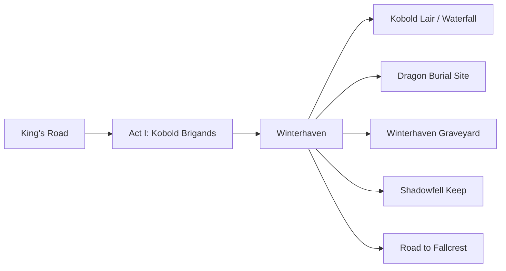
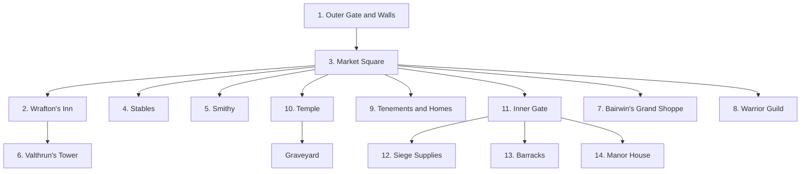
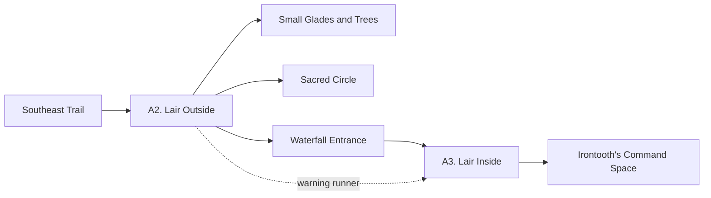
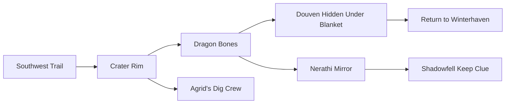
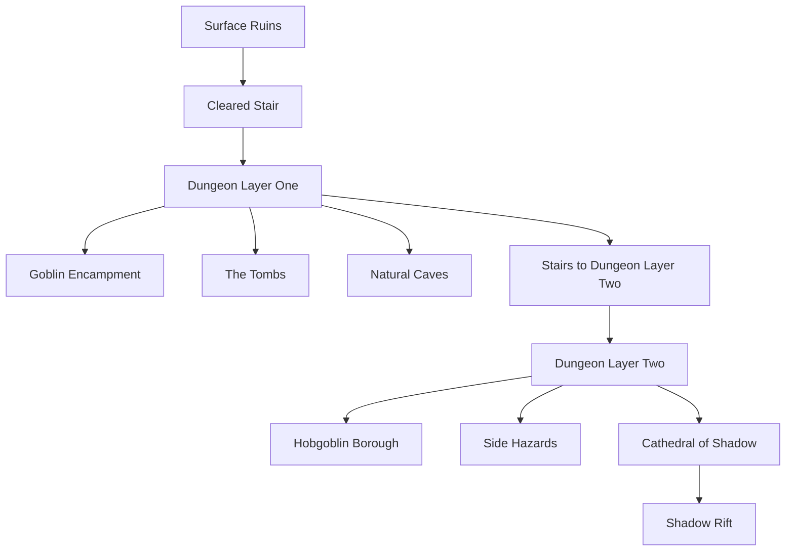
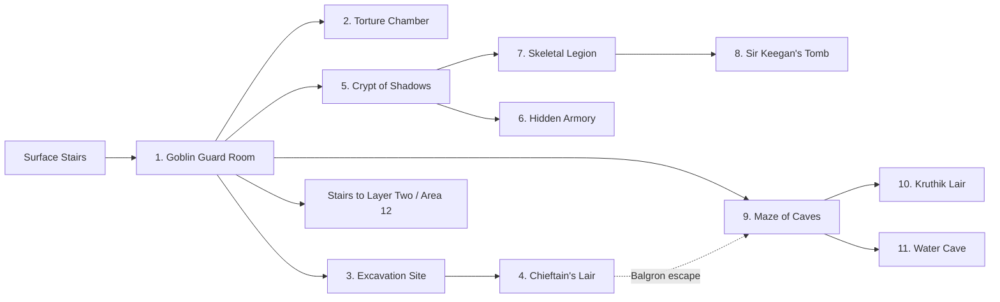
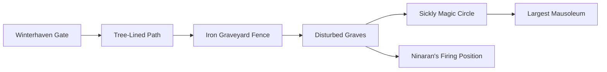
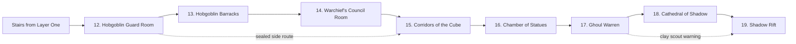

# Keep on the Shadowfell H1 - Narrative-Only Cut

This conversion preserves the adventure premise, regional context, named characters, faction motives, scene flow, location keys, clues, secrets, and sequel hooks. It removes the 4e rules layer: creature mechanics, reward math, tactical map instructions, grid procedures, difficulty numbers, power text, premade character material, quick-start rules, and image references.

Use this as a narrative seed for Hazardry or any other system. Where the original relied on checks, levels, or combat mechanics, this version describes intent, consequence, clue flow, and story pressure instead.

## Adventure at a Glance

Near the walled village of Winterhaven, a ruined imperial keep stands over a sealed wound in the world. Long ago, the rift beneath the keep opened into a dark sanctuary of Orcus. The empire of Nerath defeated the undead that poured through, sealed the rift, and built the keep to guard it.

The empire fell. The keep crumbled. Winterhaven survived as a small point of light in a darkening land.

Now Kalarel, a priest of Orcus, has rediscovered the truth. He has occupied the ruins, placed agents in the village and surrounding lands, and begun a ritual to reopen the rift. If he succeeds, undead will pour into the world, and Winterhaven will be the first meal of a much larger horror.

The adventure begins on the old King's Road with a kobold ambush and broadens into investigation, village intrigue, rescue, dungeon exploration, ancient tragedy, and a final ritual confrontation at the Shadow Rift.

## Core Themes

- A village on the edge of fear.
- Ancient imperial duty corrupted by time and tragedy.
- Small clues revealing a coordinated death cult.
- The dead refusing to stay buried.
- A sealed evil trying to return through patient ritual work.
- Heroism as the defense of ordinary people who cannot defend themselves.

## The Setting

The Shadowfell is a neighboring realm of gloom, memory, and deathly reflection. It is not wholly evil, but dangerous places within it press against the living world. In this region, the barrier is thin.

Nearly two centuries ago, a cult of Orcus opened a gap between the world and an unholy Shadowfell sanctuary. Undead spilled through until Nerath's legions destroyed them. Imperial wizards sealed the rift, and the keep was built to hold the site.

Decades later, Winterhaven grew nearby. As Nerath declined and fell, the keep was forgotten. Villagers remember it only as a haunted ruin, a place of ghosts, goblins, and bad luck.

They are more right than they know.

## The Threat

Kalarel uncovered records of the rift and became obsessed with reopening it. He believes Orcus will reward him if he breaks the old seal and restores the passage to the demon lord's sanctuary.

Kalarel has already done the following:

- Occupied the dungeons beneath Shadowfell Keep.
- Brought hobgoblins and cultists into the lower level.
- Asserted control over Balgron the Fat and the goblins on the upper dungeon level.
- Sent Irontooth to command kobolds near Winterhaven.
- Planted Ninaran, an elf spy, inside the village.
- Ordered Agrid and other agents to recover an old Nerathi mirror from a dragon burial site.
- Used undead, traps, and cult magic to guard the route to the rift.

Kalarel is close to success. Time favors him unless the heroes interrupt the ritual.

## Adventure Hooks

### Missing Mentor

Douven Staul, an old friend and mentor, came to Winterhaven three months ago in search of a dragon burial site. He believed a dragon tomb might hold relics or treasure. He has not returned.

Douven's absence brings the heroes to Winterhaven. His trail leads to the burial site southwest of the village, where Kalarel's agents have captured him.

Alternative: Douven's wife asks the heroes to find him.

### Ominous Signs

Marla, a priest of Pelor from the Great Church, has been tracking death cult activity. Witnesses saw cultists traveling toward Winterhaven about a year ago. Marla has since learned that their leader may be Kalarel, a twisted priest of Orcus.

She asks the heroes to investigate Winterhaven, confirm whether death cultists are active, and stop them if they are.

### Ruins of Empire

Parle Cranewing, a scholar of Nerath, hires the heroes to locate and map the ruined keep near Winterhaven. He expects imperial architecture, lost records, and perhaps treasure.

This hook starts as archaeology and becomes horror once the party learns what the keep was built to contain.

### Continuity Hook

For a Hazardry continuity run, the heroes may already be following threads from Traevus's stolen case, Malareth's necromancy, the Ghost Tower, or a broader pattern of relics tied to the Shadowfell. In that frame, Winterhaven is another point where old imperial seals, necromantic ambition, and demonic influence intersect.

## Act I: The King's Road

### Scene: Kobold Brigands

The heroes travel west along the old King's Road toward Winterhaven. The road has not been maintained in generations. Old cobbles show through dirt and weeds. Small clawed footprints mark the dust.

Kobold brigands wait among boulders and roadside cover. They spring an ambush, trying to isolate travelers and kill or rob them before they reach the village.

Narrative use:

- Establish that the roads around Winterhaven are no longer safe.
- Show that the kobolds are organized rather than merely opportunistic.
- Let the heroes see that local trade and travel are being strangled.
- Plant the first sense that someone is pushing small monsters into coordinated action.

Important clue:

- A kobold leader or priest carries an obsidian dragon figurine marked underneath with a ram-horned skull. This is an Orcus sign. Someone using death-cult symbolism is involved with the kobolds.

After the ambush, the road continues to Winterhaven.

## Interlude I: Arriving in Winterhaven

Winterhaven is a small walled village in the southern foothills of the Cairngorm Peaks. Farms and thatched homes surround its stone core. Dark woods lie west and south; mountains rise to the north.

Most residents have never traveled far. They live by farming, barter, local craft, and the occasional excitement of trade wagons arriving from the east. Winterhaven is modest, isolated, and nervous.

### Leadership

Lord Ernest Padraig rules by inherited authority from the old imperial line. He commands the Winterhaven Regulars, ten professional guards who handle village patrols and gate duty. If Winterhaven itself is threatened, he can muster a larger militia from the civilians, but the villagers will not march into the countryside unless desperation forces them.

Padraig knows the kobolds are becoming a serious problem, but he cannot get the village to act decisively.

### 1. Outer Gate and Walls

The gate is open by day and closed at night. Two guards are always posted. They are friendly to locals and direct travelers to Wrafton's Inn.

The walls have a narrow parapet. If Winterhaven is attacked, the Regulars and militia defend from here.

### 2. Wrafton's Inn

Wrafton's Inn is the village's public house, gathering place, tavern, and visitor lodging. Meals, beer, wine, occasional spirits, gossip, songs, and games fill the evenings.

This is the best place to meet important locals.

#### Salvana Wrafton

Salvana owns the inn. She is friendly, practical, and quick to welcome travelers with coin. She remembers Douven Staul staying at the inn before he vanished.

#### Eilian the Old

Eilian is an elderly farmer and local history enthusiast. He sits in the corner most nights and loves to talk. He gave Douven directions to the supposed dragon burial site and can sketch a map to it.

Eilian knows local tales, guesses freely, and may mistake kobolds for stranger fey creatures if pressed beyond what he truly knows.

#### Valthrun the Prescient

Valthrun is a scholar who lives in the old tower inside the village. He visits the inn to socialize and listen. He knows more about the keep than he first admits, including the truth that it was built over a Shadowfell rift.

At first he withholds the deepest facts to avoid panic and to judge whether the heroes are trustworthy.

#### Lord Padraig

Padraig sometimes visits the inn and drinks quietly at a corner table. He assumes unfamiliar travelers may be merchants or dignitaries. If they seem like mere treasure hunters, his respect cools unless they prove themselves.

He can offer a commission to deal with the kobolds.

#### Ninaran

Ninaran is a quiet elf hunter who drinks alone. She is stiff, bitter, and uninterested in ordinary conversation. Secretly, she is Kalarel's spy in Winterhaven. She reports on villagers and newcomers.

If asked about cult activity, she may send the heroes toward the kobold lair with a false story about cultists hiding near a waterfall.

### 3. Market Square

Market day draws farmers, hunters, crafters, and occasional traders. It is also a social hub where rumors travel fast.

#### Delphina Moongem

Delphina is an elf who lives a village life rather than a forest one. She sells wildflowers in the square and gathers them north of town. She has seen goblins near the ruined keep and warns visitors to be careful.

### 4. Stables

The stables fill on market days with mounts and beasts of burden. Travelers can stable mounts here, and rarely buy a horse or wagon.

### 5. Smithy

Thair Coalstriker, a dwarf smith, runs the village forge. He sells practical metal goods and can make ordinary weapons or armor with time.

Thair is blunt and often joking. He mocks the idea of a hidden cult in Winterhaven until evidence proves otherwise.

### 6. Valthrun's Tower

Valthrun lives in the upper floors of this five-story tower. The lower levels are locked and empty except for the stairway. The tower is much older than most village buildings and reinforces Valthrun's role as keeper of old knowledge.

### 7. Bairwin's Grand Shoppe

Bairwin Wildarson claims to have traveled widely before settling in Winterhaven ten years ago. His shop sells adventuring gear and occasional rarities.

Bairwin treats the kobold threat as bad for trade. His stories are expansive and may or may not be reliable.

### 8. Warrior Guild

The Warrior Guild trains villagers in basic defense. Rond Kelfem, captain of the Regulars, oversees it.

#### Rond Kelfem

Rond is frustrated by Winterhaven's limited resources. He wants the kobolds driven out and has heard the name Irontooth, but he does not know who or what Irontooth is.

### 9. Tenements and Homes

Village residents who do not own farms or who work inside the walls live here. Most people outside the walls are farmers and crafters who come to Market Square to trade.

### 10. Temple

The village temple honors several good gods, with Avandra most prominent.

#### Sister Linora

Sister Linora tends the temple, cares for villagers and animals, and helps on farms. She is not a warrior-priest, but she knows ritual care for death, disease, and restoration.

She is deeply concerned that kobolds have begun raiding outlying farms and livestock.

#### Graveyard

Winterhaven's graveyard lies south of the walled town. Sister Linora serves as caretaker. Later, this place becomes Ninaran's trap.

### 11. Inner Gate

The inner gate protects the manor district. Guards question anyone seeking Lord Padraig without appointment, though confidence, urgency, or reputation may get visitors through.

### 12. Siege Supplies

Winterhaven stores water, flour, and basic supplies in case of attack. Padraig and Sister Linora hold the keys. These supplies matter if the undead threat spills out from the keep.

### 13. Barracks

The Regulars live and rest here. During the day most are on patrol; at night most sleep here while two stand at the gate.

### 14. Manor House

Lord Padraig, his wife, and their four sons live in an old imperial-style manor. Padraig will meet adventurers who seek him out, especially if they bring news of the kobolds.

## Map as Node-Edge Graphs: Winterhaven and the Region

These graphs abstract the regional and village maps into story navigation. Use
them to orient the AI GM before deciding which local scene to frame next.

### Regional Route Graph

#### Edge List

- King's Road -> Act I: Kobold Brigands.
- Act I: Kobold Brigands -> Winterhaven.
- Winterhaven -> Kobold Lair / Waterfall.
- Winterhaven -> Dragon Burial Site.
- Winterhaven -> Winterhaven Graveyard.
- Winterhaven -> Shadowfell Keep.
- Winterhaven -> Road to Fallcrest.

### Winterhaven Village Graph

#### Edge List

- 1. Outer Gate and Walls -> 3. Market Square.
- 3. Market Square -> 2. Wrafton's Inn.
- 3. Market Square -> 4. Stables.
- 3. Market Square -> 5. Smithy.
- 3. Market Square -> 10. Temple.
- 3. Market Square -> 9. Tenements and Homes.
- 3. Market Square -> 11. Inner Gate.
- 2. Wrafton's Inn -> 6. Valthrun's Tower.
- 3. Market Square -> 7. Bairwin's Grand Shoppe.
- 3. Market Square -> 8. Warrior Guild.
- 10. Temple -> Graveyard.
- 11. Inner Gate -> 12. Siege Supplies.
- 11. Inner Gate -> 13. Barracks.
- 11. Inner Gate -> 14. Manor House.

## Winterhaven Questions and Clues

### Douven Staul

Salvana remembers Douven staying at the inn. Eilian gave Douven directions to the old burial site and can provide a map. Valthrun confirms that an old dragon-related site may lie southwest of the village, though he has no firsthand knowledge.

This points to the Burial Site scene.

### The Old Keep

Salvana says the keep lies northeast of the village in the Cairngorm foothills and warns that no sensible person goes there. Valthrun says it was built by Nerath, though he initially claims not to remember its purpose. Delphina has seen goblins near the ruins.

This points to Shadowfell Keep.

### Kobolds on the Road

Most villagers know the kobolds have grown bolder. Salvana points heroes toward Padraig. Sister Linora fears the farm raids are a sign of worse things. Thair calls the kobolds a threat to trade. Rond wants information about Irontooth.

Padraig offers a commission to eliminate the kobolds and provides directions to their lair.

### Cult Activity

Most villagers dismiss the idea. Valthrun says no true cult has operated nearby in generations, but this is before he sees evidence. Ninaran pretends concern and sends heroes toward the kobold lair by claiming cultists use a cave behind a waterfall.

Her lie still sends the heroes toward useful clues.

## Act II: Kobolds, Irontooth, and Douven

### A1. Kobold Ambush

After the heroes leave Winterhaven, kobolds strike again. This group is more disciplined than the first. They wait in concealment and attack when the party is vulnerable.

Narrative use:

- Show that the kobolds are reacting to the heroes' arrival.
- Escalate from roadside bandits to organized hunters.
- Reinforce that someone is coordinating the attacks.

Important clue:

- A kobold wyrmpriest carries an obsidian dragon figurine marked with Orcus's ram-horned skull. This confirms that the kobolds' leadership is tied to a death cult or someone imitating one.

### A2. Kobold Lair, Outside

The kobold lair lies southeast of Winterhaven near a waterfall and forested cliff. Small glades lead toward the falling water. Voices can be heard over the roar if the heroes approach quietly.

The outside guards include numerous lesser kobolds, better-armed defenders, and a slinger who may run inside to warn Irontooth.

Scene features:

- A cliffside waterfall conceals the cave entrance.
- Trees offer cover and make stealth possible.
- A rune-marked sacred circle glows with old magic near the lair.
- The stream and rocks make the approach noisy and awkward.

Narrative outcomes:

- If the heroes stop the warning runner, the interior is less prepared.
- If the warning reaches the lair, Irontooth and his forces organize quickly.
- The outside guards assume the cave defenders can handle anything that gets past them.

### A3. Kobold Lair, Inside

Inside the cave, kobolds scurry through torchlit hollows. Screams, alarms, and horn calls echo through the stone. The defense comes in waves: first the common lair defenders, then stronger kobolds and Irontooth.

Irontooth is a scarred goblin leader with a wolf-fur cloak, battleaxe, chain shirt, and a ram-skull tattoo on his face. He is feared by the kobolds and zealous in service to Kalarel and Orcus.

Important clues:

- Irontooth carries a message from Kalarel.
- The message mentions a spy in Winterhaven.
- Kalarel says the rift will open in a few days.
- The message frames Winterhaven's people as future food for Orcus's servants.
- Irontooth dies invoking Kalarel and Orcus.

Treasure and story rewards:

- Stolen goods from travelers remain in the lair.
- Irontooth keeps a key and a locked chest.
- Any useful equipment can be adapted as system-neutral reward.

This scene should leave no doubt that Winterhaven faces more than random kobold raids.

### A4. Dragon Burial Site

Douven Staul did find the dragon burial site, but Kalarel's agents found it too. Agrid, a gnome skulk, now holds Douven prisoner and forces him to help search the site.

The site is a steep-sided crater in the wilderness. Figures work near dragon bones. Small draconic guard beasts watch the rim. Douven is gagged, bound, and hidden beneath a blanket.

Agrid tries deception first. He claims to be Douven's associate and invites the heroes closer to see the discovery. If his lie fails or the heroes interfere, he orders the attack.

Important elements:

- Douven is alive but captive.
- Agrid has uncovered the relic Kalarel wanted: an ancient mirror once owned by a Nerathi wizard involved in sealing the rift.
- The mirror is not overtly magical now, but it has symbolic and ritual value.
- Agrid's force includes hired thugs and trained drake-like beasts.

If Douven is freed, he returns to his wife and thanks the heroes. He offers his amulet as a reward after removing his wife's portrait from inside it. This is less about loot than affection: Douven values the portrait more than the magic.

### Map as Node-Edge Graphs: Kobold Lair and Burial Site

#### Kobold Lair Graph

##### Edge List

- Southeast Trail -> A2. Lair Outside.
- A2. Lair Outside -> Small Glades and Trees.
- A2. Lair Outside -> Sacred Circle.
- A2. Lair Outside -> Waterfall Entrance.
- Waterfall Entrance -> A3. Lair Inside.
- A3. Lair Inside -> Irontooth's Command Space.
- A2. Lair Outside -. warning runner .-> A3. Lair Inside.

#### Dragon Burial Site Graph

##### Edge List

- Southwest Trail -> Crater Rim.
- Crater Rim -> Dragon Bones.
- Crater Rim -> Agrid's Dig Crew.
- Dragon Bones -> Douven Hidden Under Blanket.
- Dragon Bones -> Nerathi Mirror.
- Douven Hidden Under Blanket -> Return to Winterhaven.
- Nerathi Mirror -> Shadowfell Keep Clue.

## Interlude II: Shadow of the Keep

After the heroes collect clues and return to Winterhaven, the village has changed. Fields around the walls seem empty. Villagers hurry through the streets and glance over their shoulders. Fear has entered the air.

### Nervous Villagers

Some villagers cannot explain their dread. Eilian dreams of a dark door opening somewhere. Salvana deflects with irritation. Ninaran, if still present, feigns relief that the heroes survived.

### Valthrun Reveals the Truth

Once the heroes have proven themselves and bring evidence of Orcus activity, Valthrun stops holding back. He explains that the keep was built by Nerath over a rift to the Shadowfell. The rift connects to an Orcus sanctuary. The empire sealed it after undead flooded through.

If the seal fails now, Winterhaven has no empire to summon. The village will be overwhelmed.

### Padraig and the Village

If duty is not enough, Valthrun and Padraig can arrange a reward from the village coffers. Padraig remains in Winterhaven to defend the village with the Regulars. Valthrun is too old to accompany the heroes. The villagers can cheer and hope, but the work belongs to the heroes.

### Ninaran Disappears

If the heroes look for Ninaran, she is gone. She has left to warn Kalarel and prepare the graveyard trap.

### Departure

When the heroes leave for Shadowfell Keep, villagers gather at the gates and cheer them as the Heroes of Winterhaven. This public hope can make later failure more painful.

## Shadowfell Keep

### Approaching the Ruins

The road to Shadowfell Keep is overgrown and difficult. No one maintains it. As the heroes near the ruin, the forest seems to fall silent. Insects stop. Wind dies. Cold gathers even in daylight.

The clearing around the keep is bare dirt and broken stone. No plants grow among the scorched timbers and shattered blocks. Someone has recently cleared a path through the rubble, revealing a stone staircase descending into darkness.

### The Legend of Sir Keegan

Villagers know the keep as a cursed ruin. They say Sir Keegan, commander of the garrison, went mad one midnight and slaughtered everyone in the keep: wife, children, advisors, captains, soldiers. The surviving garrison drove him into the passages below and killed him there.

His ghost is said to wander the dungeons, grieving or hunting.

### The Real Story

Sir Keegan was an honorable paladin. The Shadow Rift whispered into his dreams and fed his fears. The fall of Nerath and the rift's corruption broke him. He came to believe the people around him were traitors conspiring to open the rift.

He murdered his family and many comrades. Gravely wounded in the garrison's response, he fled into the crypts. There his senses returned. Crushed by remorse, he poisoned himself in a secret tomb.

His spirit remains, waiting for someone worthy to redeem his oath: keep the Shadow Rift closed forever.

### Running the Keep as Story

Treat the keep as more than a sequence of fights. It is a place where imperial duty failed, a family was murdered, the dead were disturbed, and an old seal is being broken.

Use recurring sensory motifs:

- Sudden cold.
- Flickering shadows at the edge of light.
- Distant moans.
- Footsteps that stop when listened for.
- Old stone that feels watched.
- Silence outside the ruin and whispers below it.

## Map as Node-Edge Graph: Shadowfell Keep Overview

This graph is the adventure-scale dungeon map: surface ruin, first layer,
second layer, and the final rift. The layer-specific graphs below expand the
two dungeon floors.

### Edge List

- Surface Ruins -> Cleared Stair.
- Cleared Stair -> Dungeon Layer One.
- Dungeon Layer One -> Goblin Encampment.
- Dungeon Layer One -> The Tombs.
- Dungeon Layer One -> Natural Caves.
- Dungeon Layer One -> Stairs to Dungeon Layer Two.
- Stairs to Dungeon Layer Two -> Dungeon Layer Two.
- Dungeon Layer Two -> Hobgoblin Borough.
- Dungeon Layer Two -> Side Hazards.
- Dungeon Layer Two -> Cathedral of Shadow.
- Cathedral of Shadow -> Shadow Rift.

## Shadowfell Keep: Dungeon Layer One

The first dungeon layer contains three main zones: the goblin encampment, the tombs, and natural caves.

### Map as Node-Edge Graph: Dungeon Layer One

#### Edge List

- Surface Stairs -> 1. Goblin Guard Room.
- 1. Goblin Guard Room -> 2. Torture Chamber.
- 1. Goblin Guard Room -> 3. Excavation Site.
- 3. Excavation Site -> 4. Chieftain's Lair.
- 1. Goblin Guard Room -> 5. Crypt of Shadows.
- 5. Crypt of Shadows -> 6. Hidden Armory.
- 5. Crypt of Shadows -> 7. Skeletal Legion.
- 7. Skeletal Legion -> 8. Sir Keegan's Tomb.
- 1. Goblin Guard Room -> 9. Maze of Caves.
- 4. Chieftain's Lair -. Balgron escape .-> 9. Maze of Caves.
- 9. Maze of Caves -> 10. Kruthik Lair.
- 9. Maze of Caves -> 11. Water Cave.
- 1. Goblin Guard Room -> Stairs to Layer Two / Area 12.

### Faction: Balgron's Goblins

Balgron the Fat commands the goblins stationed on the first level. They guard, dig, torture prisoners, and try to avoid Kalarel's displeasure. They are greedy, cowardly, and dangerous in groups.

Balgron cares only about survival. If cornered, he begs for mercy. If spared, he may serve briefly, then betray the heroes at the first opportunity.

### Zone: Goblin Encampment

This zone includes the entrance guard room, torture chamber, excavation site, and Balgron's lair.

#### Area 1: Goblin Guard Room

At the base of the stairs, goblins lounge in a guard room more interested in dice, jokes, and boredom than vigilance. A hidden pit in the center holds a swarm of hungry rats. The goblins use the rats as both trap and entertainment.

Scene elements:

- Smell of unwashed bodies.
- Chittering beneath a canvas or stone-colored cover.
- Goblins playing games or daring each other near forbidden doors.
- A survivor may flee to warn Areas 2 or 3.

Narrative use:

- Introduce the keep as occupied by petty but organized enemies.
- Show that the goblins have adapted the dungeon to their own crude habits.
- Let the rat pit become chaos for both sides.

#### Area 2: Torture Chamber

A hobgoblin torturer works here with goblin assistants. The area includes a work room full of cruel implements and a cellblock with locked cells.

Scene elements:

- Iron maiden.
- Fire pit and heated rods.
- Tables of blades and tools.
- Rack and cage.
- Three cells to the west.

The torturer is a foul-mouthed braggart in black leather armor and a mask hiding burn scars. He uses the chamber itself as a weapon.

##### Splug

Splug, a goblin con artist, sits in the middle cell. Other goblins jailed him after he tricked too many of them out of ale rations.

He begs for release and promises to serve as porter, camp servant, guide, or anything else the heroes want. He acts pathetic and loyal but is a habitual liar.

What Splug knows:

- Accurate information about Areas 1-4.
- Goblin habits and Balgron's fearfulness.
- Little or nothing about deeper dungeon levels.

Use Splug as comic relief, temporary guide, future betrayer, or all three.

#### Area 3: Excavation Site

Balgron told his followers that treasure lies buried here, partly to keep them busy. Weeks of digging have uncovered almost nothing. The goblins are angry, exhausted, and arguing when the heroes arrive.

Scene elements:

- A chamber dug down below its original floor.
- Narrow planks crossing pits and trenches.
- Goblins with picks and shovels.
- Guard drakes defending the workers.
- Piles of loose earth.

Story reward:

- The goblins have uncovered a dirt-covered holy symbol of Bahamut. In a custom system, this can become a sign that the keep once belonged to defenders of justice and protection.

#### Area 4: Chieftain's Lair

Balgron's chambers include a guard room, bunkhouse, storage, barracks, and his personal room hidden behind tapestries. A secret route can let careful heroes reach him before his followers respond.

Balgron is obese, cruel, suspicious, and cowardly. If awakened or threatened, he tries to flee toward his guards. If reduced to desperation, he begs and bargains.

Important information:

- Balgron can reveal the true pass phrase to the second level: "And life fails in the dark."
- He knows enough to fear Kalarel and the hobgoblins below.
- He will sacrifice followers to save himself.
- If spared, he will betray the heroes when safe.

Story rewards:

- Balgron's chest contains money and a magic wand or equivalent arcane implement.
- The real treasure may be the pass phrase and an understanding of goblin faction politics.

### Zone: The Tombs

The tombs were built for the keep's imperial dead. When clerics still served the keep, they performed rites to prevent the dead from rising. Those rites are gone, and the rift's influence has awakened old corpses.

The undead of this zone generally do not leave the tomb area. They are bound by place, ritual, and corruption.

#### Area 5: Crypt of Shadows

Discolored stairs descend into cold darkness. Damp rot fills the air. Terror runes on the floor scream when touched, filling intruders with panic and drawing zombies from nearby chambers.

Scene elements:

- Runes that release throat-tearing screams.
- Zombies standing idle until sound or movement calls them.
- Magical fear that drives victims toward the skeletal legion.
- Darkness unless the heroes bring light.

Narrative use:

- The room weaponizes fear and flight.
- Kalarel's allies and undead are unaffected, showing that the dungeon has been prepared for them.

#### Area 6: Hidden Armory

A secret door in the crypts leads to what first appears to be a bare room. The far wall shimmers faintly. It is an illusory barrier. Beyond it, undead guardians wait in a forgotten armory.

Scene elements:

- Hidden ceiling trigger for the secret door.
- One-way illusory wall.
- Zombies watching from behind the false wall.
- Weapon racks, old armor, and a steel plaque bearing a helm.

The plaque speaks a riddle after the guardians are defeated. The answer is reputation, honor, or a close equivalent. If answered well, a ragged suit of armor shines and becomes a true relic. If mocked or failed repeatedly, the treasure collapses into ruin.

Safe haven:

- Once cleared, the armory becomes a hidden resting place. The secret door and illusory wall can protect the heroes from patrols, though hobgoblins may eventually discover it if alerted.

#### Area 7: Skeletal Legion

Ten great sarcophagi line this crypt. The eastern end glows with silvery light from a dome showing Bahamut, the Platinum Dragon, flying across a starry sky. Altars bear prayers to Bahamut as protector and refuge.

When intruders pass the central sarcophagi, lids slam open and skeletons spill out. More skeletons emerge in waves unless the heroes stop the effect.

Ways to resolve:

- Destroy or seal sarcophagi.
- Retreat.
- Reach the altars and offer sincere praise to Bahamut.

If the heroes kneel and honor Bahamut, the light brightens, the skeletons cease attacking, and the chamber becomes safe. This is an important thematic beat: reverence and honor can stop violence where force alone only prolongs it.

Story rewards:

- The altars and dragon imagery prepare the heroes for Sir Keegan.
- Small platinum dragon statues or similar tokens may become symbols of Bahamut's boon in the final confrontation.

#### Area 8: Sir Keegan's Tomb

A single coffin rests on a raised dais. The lid shows a warrior in plate armor with a sword laid across his chest.

When disturbed, the coffin bursts open and Sir Keegan's skeletal spirit rises with the sword Aecris. He demands that the rift never be reopened and orders the heroes to state their business or die.

This is primarily a social and moral scene.

Keegan's assumptions:

- Tomb robbers deserve death.
- Agents of the cult deserve death.
- Only those committed to closing the rift deserve his aid.

How to calm him:

- Explain the threat from Kalarel.
- Show evidence of Orcus activity.
- Speak of protecting Winterhaven.
- Invoke Bahamut, duty, honor, or redemption.
- Treat his tragedy with respect rather than contempt.

If persuaded, Keegan speaks.

What Keegan reveals:

- He was commander of the keep garrison.
- The rift's corruption entered his dreams and mind.
- In madness, he murdered his wife, children, advisors, and soldiers.
- He fled into the crypts when the garrison rallied against him.
- His sanity returned too late.
- He poisoned himself rather than live with what he had done.
- The rift is a gate to an Orcus sanctuary in the Shadowfell.
- His duty remains unfinished.

Keegan's charge:

- Purge the keep of those trying to open the rift.
- Keep the seal intact.
- Seek Bahamut's aid at the altars outside.
- Redeem Aecris, the sword he could not redeem through his own life.

Story reward:

- Aecris becomes a major relic. In Hazardry terms, it can be an oath-bound blade tied to imperial duty, remorse, and protection against the undead.

If the heroes fail to persuade him or treat him as an enemy, Keegan attacks.

### Zone: Natural Caves

Natural caves intersect the first dungeon level. The goblins feed the creatures there to keep them from roaming, but hunger makes these areas unpredictable.

#### Area 9: The Maze of Caves

Worked stone gives way to natural cavern. Stalactites and stalagmites crowd the paths, and the floor rises unevenly.

Predators lurk here: rats and an ooze that prefers isolated prey. These creatures are not part of Kalarel's command structure. They are opportunistic dungeon ecology.

Narrative use:

- Break the pattern of organized enemies.
- Show that the keep is old enough to have become a living ecosystem.
- Let fleeing heroes or monsters trigger messy three-way danger.

#### Area 10: Kruthik Lair

This chamber belongs to kruthiks: six-limbed reptile-insect predators with silvery chitin and scythelike claws. They have burrowed narrow tunnels through the walls, allowing them to appear, vanish, and surround prey.

Scene elements:

- A broken pit containing a dead kruthik and a dead goblin.
- Camouflaged pits dug by goblins to fight the infestation.
- Musk in the air.
- A pile of coins and objects in the kruthik nest.

Narrative use:

- Show that the goblins are not fully in control of the first level.
- Let environmental traps hurt monsters as well as heroes.
- Make the dungeon feel contested rather than static.

#### Area 11: The Water Cave

Bronze double doors are green with age and stained by fungus. Scratched into the fungus is a warning telling intruders to stay out.

Beyond the doors, stairs descend to a stagnant pool. A small island rises in the center, littered with bones, coins, and objects under a carpet of fungus.

History:

- This cave was once the keep's cistern.
- It was sealed after two children drowned there.
- After Keegan's massacre and the keep's abandonment, the water stagnated.
- Later, Bloodreaver messengers came to Kalarel offering to buy captives for duergar allies in Thunderspire.
- Kalarel was irritated by the interruption and had his hobgoblins drown the messengers in the cistern.
- Something vile woke in the water: a blue slime or similar mindless hunger.
- Several goblins and hobgoblins died trying to remove it.
- Kalarel forbade his followers from entering.

Important clue:

A wooden message cylinder survives on the island. It contains:

- A map showing Shadowfell Keep.
- A warning that water activates a dormant creature or nodule.
- A letter from Chief Krand of the Bloodreavers offering to buy humanoid captives for duergar allies in Thunderspire.

This is a major sequel hook toward Thunderspire Labyrinth or any Hazardry equivalent involving slavers, duergar, and subterranean trade.

## Interlude III: The Dead Walk

The first time the heroes return to Winterhaven after exploring part of Shadowfell Keep, but before defeating Kalarel, Ninaran springs a trap prepared by Kalarel.

Winterhaven's gates are closed. Guards stand with weapons drawn on the parapet. Lord Padraig calls down that villagers have disappeared and the dead in the cemetery have risen. He fears the undead will assault the gates and drag everyone away.

Padraig asks the heroes to deal with the graveyard.

### Graveyard Scene

A path leads from the gate through trees to the cemetery. Iron bars enclose packed tombstones and three mausoleums. Soil around some graves is disturbed. A sickly glow pulses near the largest mausoleum.

When the heroes reach the center, undead burst from the soil. Gravehound zombies and skeletons attack while Ninaran emerges from hiding and fires into the chaos.

#### Map as Node-Edge Graph: Winterhaven Graveyard

##### Edge List

- Winterhaven Gate -> Tree-Lined Path.
- Tree-Lined Path -> Iron Graveyard Fence.
- Iron Graveyard Fence -> Disturbed Graves.
- Disturbed Graves -> Sickly Magic Circle.
- Sickly Magic Circle -> Largest Mausoleum.
- Disturbed Graves -> Ninaran's Firing Position.

Ninaran's role:

- She is Kalarel's spy and assassin.
- She prepared a magic circle using blood and an elixir sent by Kalarel.
- She hopes the undead will overwhelm the heroes before they can return to the keep.

Magic circle:

- The circle sustains the undead animation.
- Magical or religious action can disrupt it, causing the undead to collapse.
- Destroying or cleansing the circle should feel like breaking Kalarel's influence over the village dead.

Ninaran's note:

- Kalarel orders her to end the heroes' meddling.
- He says he is close to completion.
- The note gives a false pass phrase for the second keep level: "From the ground, some magic was found."

If Ninaran is captured, she may reveal the true phrase: "And life fails in the dark."

If the heroes refuse to help:

- Padraig and the militia eventually defeat the undead.
- Several villagers die.
- Winterhaven becomes cold or hostile toward the heroes, even if they later defeat Kalarel.

## Shadowfell Keep: Dungeon Layer Two

The second dungeon layer includes the hobgoblin borough, dangerous side chambers, the Cathedral of Shadow, and the Shadow Rift.

### Map as Node-Edge Graph: Dungeon Layer Two

#### Edge List

- Stairs from Layer One -> 12. Hobgoblin Guard Room.
- 12. Hobgoblin Guard Room -> 13. Hobgoblin Barracks.
- 13. Hobgoblin Barracks -> 14. Warchief's Council Room.
- 14. Warchief's Council Room -> 15. Corridors of the Cube.
- 15. Corridors of the Cube -> 16. Chamber of Statues.
- 16. Chamber of Statues -> 17. Ghoul Warren.
- 17. Ghoul Warren -> 18. Cathedral of Shadow.
- 18. Cathedral of Shadow -> 19. Shadow Rift.
- 12. Hobgoblin Guard Room -. sealed side route .-> 15. Corridors of the Cube.
- 17. Ghoul Warren -. clay scout warning .-> 19. Shadow Rift.

### Faction: The Hobgoblins

Kalarel's lower-level soldiers are hobgoblins led by a commander known simply as the Warchief. They are disciplined, cruel, and proud. They do not scare as easily as kobolds or goblins.

They also have ambitions beyond Kalarel. The Warchief dreams of commanding an army, attacking Winterhaven, and selling captives to the Bloodreavers.

### Wandering Patrols

Hobgoblin patrols may reoccupy cleared areas, especially if the heroes leave and return. Use patrols as story pressure, not filler: they show that the lower level is an armed camp responding to intrusion.

### Area 12: Hobgoblin Guard Room

The stairs descend to torchlit chambers. Hobgoblin guards challenge anyone arriving with the phrase: "Shadow seeks shadow."

The correct response is: "And life fails in the dark."

Outcomes:

- Wrong phrase: the guards attack.
- Ninaran's false phrase: the guards realize Ninaran is dead and try to warn Kalarel.
- Correct phrase: the guards become suspicious and demand to know the visitors' business with Kalarel.

The guard room includes wells and a caged deathjump spider used as a war beast. Hobgoblin grunts try to release it if fighting breaks out. The wells are dangerous and can become brutal environmental hazards.

Narrative use:

- Reward prior clue gathering.
- Show organized security, not just dungeon monsters.
- Make Ninaran's false pass phrase meaningful even after death.

### Area 13: Hobgoblin Barracks

A lone hobgoblin soldier investigates sounds near the storeroom. If he sees intruders, he shouts an alarm and retreats toward the barracks.

Scene elements:

- Supply stores of salted fish, jerky, grain, tubers, water, and hidden beer casks.
- Straw beds and common tables used for bone dice.
- A warcaster, archer, soldiers, and grunts coordinating in living quarters.

If the heroes ignore the barracks, the hobgoblins may follow and strike during another scene. This is a good way to make the dungeon feel reactive.

### Area 14: Warchief's Council Room

The Warchief's council room and quarters lie behind an alarm panel and portcullis. Bedchamber doors have spy holes, allowing defenders to observe intruders before attacking.

Scene elements:

- A massive scarred table covered with mugs and crumpled parchments.
- The Warchief waiting with grunts in one room while soldiers wait in another.
- A sudden ambush through multiple doors.
- The Warchief shouting not to kill the heroes because they can be sold to the Bloodreavers.

Important clue:

- Crumpled plans on the council table depict an attack on Winterhaven involving hobgoblins and hundreds of undead.

This scene clarifies the stakes: if Kalarel's work continues, Winterhaven is not merely endangered by accident. It is a target.

### Area 15: Corridors of the Cube

The hobgoblins have boarded up these doors and written a warning that the area is closed. The floor inside is unnaturally clean.

Two dangers wait:

- A nearly invisible gelatinous cube filling part of the corridor.
- Corruption corpses sealed in sarcophagi.

The cube and undead can catch intruders between them. The cube is mindless and attacks anything, including undead.

Story reward:

A small chest contains belongings of Sir Keegan's children:

- A gold medallion etched with Drystan Keegan's name.
- A platinum bracelet etched with Ceinwein Keegan's name.
- A toy sword.
- A child's doll.
- A mother-of-pearl hairbrush.
- A protective amulet.

These relics are emotionally important. They make Keegan's crime personal and may influence how the heroes treat his spirit.

### Area 16: Chamber of Statues

This chamber appears to be a memorial but is actually an elaborate death trap. Evil creatures and Kalarel's companions can pass safely; others trigger the mechanisms.

Scene elements:

- A towering warrior statue with an outstretched sword.
- Two crouching dragon statues.
- Four cherub statues holding vases.
- Doors that slam shut and bolt when traps activate.
- A water-filled arcane cage that can become a whirlpool.
- Magical force from the dragon statues.

Narrative use:

- Show that Kalarel or earlier builders prepared defenses that distinguish allies from intruders.
- Use the chamber as a puzzle-hazard rather than a numbers exercise.
- Let clever heroes disable, destroy, outmaneuver, or exploit the traps.

### Area 17: Ghoul Warren

The smell of rotting meat pours from this room. Half-eaten bodies of goblins, hobgoblins, humans, elves, and animals lie scattered through the chamber. A narrow low tunnel leads to an even more gruesome brick-lined space.

Kalarel keeps undead here as a final security layer before the cathedral. A ghoul leads the flesh-eating dead, while a clay scout watches and may flee to warn Kalarel.

Scene elements:

- A ghoul that waits for zombies to pin prey before striking.
- Rotters and zombies mimicking the ghoul's hunger.
- A clay homunculus that can carry warning to Kalarel.
- A small tunnel to discarded belongings and a bag of holding or equivalent container.

If the clay scout escapes, Kalarel is prepared in the final chamber.

### Area 18: Cathedral of Shadow

This is a subtemple to the rift chamber below. Blood from sacrifices runs across the floor into a grate around a central pit, feeding Kalarel's ritual. Blue-green crystal columns light the shadowed cathedral.

At the eastern dais, an underpriest of Orcus raises a knife and chants praise to the demon lord. A ram-skull tattoo covers his face.

Forces present:

- Orcus underpriest.
- Human berserkers muttering prayers to Orcus.
- Vampire spawn.
- A dark creeper working from the shadows.
- Possibly the clay scout fleeing toward Kalarel.

Scene elements:

- Crimson streams of blood.
- Central pit descending to the Shadow Rift.
- Chains slick with blood leading down.
- Crystal columns with eerie light.
- A sense that the ritual below is actively drawing power from sacrifice above.

If the heroes defeat the cathedral guardians, they can descend the blood-slick chains into the final chamber.

### Area 19: The Shadow Rift

The heroes descend into a nightmare.

Blood falls from above and pools in the chamber. A black portal dominates the northern wall. Something presses against the darkness from the other side, as if the portal is only a thin membrane holding back a clawed horror.

A massive statue of Orcus points toward the rift with a skull-capped wand. Smaller Orcus statues flank an eastern platform. To the west, a bone altar stands between broad pillars. Kalarel waits behind it in heavy armor, eyes closed over an open ritual book, chanting.

Kalarel is no longer merely plotting. The ritual is underway.

#### Kalarel

Kalarel is arrogant, fanatical, and certain he is on the edge of triumph. He should feel hate-worthy, not merely dangerous. He taunts the heroes, brags that their corpses will serve him, and treats their arrival as an insult to his destiny.

If warned by the clay scout, he is ready. If not, the heroes interrupt him mid-rite.

Kalarel's behavior:

- He retreats toward the evil magic circle near the rift.
- He uses undead guardians to keep heroes away.
- He tries to force enemies into reach of the Thing in the Portal.
- He prioritizes finishing the ritual unless survival requires otherwise.

#### The Thing in the Portal

Something waits just beyond the rift. It reaches through the portal, clawing at those who come too close. It is not fully in the world, but it can drag victims toward the threshold.

If Kalarel dies near the rift, the Thing may seize him and drag him through, suggesting Orcus has not finished with him. This makes Kalarel available as a future undead or shadow-taken villain.

#### Other Defenders

- Skeleton warriors protect Kalarel.
- A deathlock wight attacks from a platform.
- The room's Orcus statues strengthen undead magic.
- The evil circle empowers Kalarel and his servants.

#### The Rift

The Shadow Rift opens into a temple of Orcus in the Shadowfell. Crossing the threshold should be treated as death, exile, transformation, or some other campaign-defining catastrophe.

#### Reversing the Ritual

The heroes do not have to rely only on killing Kalarel. The abandoned ritual book and altar allow a daring attempt to reverse the rite.

To do this in a custom system, frame it as a parallel ritual challenge while the battle continues:

- Study the structure of the rite.
- Identify where Orcus's power is anchored.
- Reverse phrases, sigils, blood flows, or offerings.
- Channel life, faith, memory, or protective oaths into the book.
- Endure necrotic backlash from the half-open rift.
- Coordinate defenders and ritual-workers under pressure.

If the reversal succeeds, black fire consumes the ritual book and the rift collapses or seals. If it fails, the rift remains partially open until Kalarel is defeated or the heroes find another way.

This option is especially useful for Hazardry because it lets the finale become a contest of meaning and ritual agency, not only a fight.

## Conclusion

If the heroes defeat Kalarel and prevent the Shadow Rift from reopening, Winterhaven is saved.

When they return, villagers who know of their mission rejoice. Lord Padraig holds a feast in their honor. The village has survived because a few people did what its walls and frightened militia could not.

Loose threads remain:

- Kalarel may have been dragged through the rift instead of destroyed.
- The Bloodreavers and their duergar allies in Thunderspire are active nearby.
- The Warchief's plans show that Winterhaven could still become a target.
- The relics of Sir Keegan's family may need proper burial or remembrance.
- Aecris and the Bahamut icons may carry a continuing oath.
- The Nerathi mirror from the burial site may connect to the original sealing ritual.
- The broader Shadowfell may still press against weak places in the world.

## Clue Index

### Orcus Symbol on the Kobolds

The obsidian dragon figurine marked with a ram-horned skull links the kobolds to Orcus. This is the first cult clue.

### Irontooth's Scroll

Kalarel's message to Irontooth reveals a spy in Winterhaven, says the rift will open soon, and names Orcus as the power behind the plot.

### Ninaran's Behavior

Ninaran avoids conversation, sends the heroes toward the kobold lair under false pretenses, later vanishes, and then attacks them through the graveyard trap.

### Eilian's Map

Eilian can direct the heroes to Douven's burial site. His local history gossip is useful even when imprecise.

### Douven's Captivity

Douven proves the burial site was real and that Kalarel's agents are collecting ritual relics, not merely treasure.

### The Nerathi Mirror

Agrid recovered an ancient mirror belonging to a Nerathi wizard who helped seal the rift. It is a ritual-context clue and a possible Hazardry relic.

### Valthrun's Revelation

Valthrun identifies Shadowfell Keep as a rift-seal site built by Nerath. This converts scattered clues into the central mission.

### Balgron's Pass Phrase

Balgron can reveal the true phrase: "And life fails in the dark."

### Ninaran's False Pass Phrase

Kalarel's note to Ninaran includes the false phrase: "From the ground, some magic was found." This lets the hobgoblins know Ninaran is dead if the heroes use it.

### Bloodreaver Letter

Chief Krand offers to buy captives for duergar allies in Thunderspire. This points beyond H1 toward slavers and underworld politics.

### Warchief's War Plans

The council room papers depict an attack on Winterhaven using hobgoblins and undead. This proves Kalarel's network intended active conquest, not only ritual secrecy.

### Sir Keegan's Family Relics

The medallion, bracelet, toy sword, doll, and hairbrush make Keegan's massacre concrete. They can soften or complicate the encounter with his spirit.

### Aecris

Sir Keegan's sword is a redemptive relic. Its story is more important than its combat value.

### The Ritual Book

The book in the Shadow Rift chamber can be used to reverse the opening rite or can be destroyed when the rift closes.

## Named Cast

### Kalarel

Priest of Orcus and main villain. He seeks to reopen the Shadow Rift beneath the keep and establish a foothold for undead horrors. He is arrogant, fanatical, and close to success.

### Ninaran

Elf hunter and spy in Winterhaven. She reports to Kalarel, misdirects the heroes, and later prepares the graveyard undead trap.

### Irontooth

Scarred goblin commander of the kobolds. He bears a ram-skull tattoo and dies invoking Kalarel and Orcus.

### Balgron the Fat

Goblin chieftain of the keep's upper level. Cowardly, selfish, and treacherous. Knows the true pass phrase to the second level.

### Splug

Goblin prisoner and con artist in the torture chamber. Useful guide to the upper goblin areas, comic relief, potential betrayer.

### Sir Keegan

Tragic former commander of the keep. Corrupted by whispers from the rift, he murdered his family and garrison, regained sanity, and killed himself. His spirit seeks redemption through the heroes.

### Lord Ernest Padraig

Ruler of Winterhaven. Decent but limited by fear, politics, and small resources. Wants the kobolds eliminated and later supports action against the keep.

### Salvana Wrafton

Owner of Wrafton's Inn. Friendly, practical, and a useful source of local social information.

### Eilian the Old

Talkative farmer and amateur historian. Knows the route to the burial site and many local tales.

### Valthrun the Prescient

Village sage. Holds back the truth at first, then reveals the keep's purpose when evidence of Orcus appears.

### Sister Linora

Priest of Avandra and caretaker of the graveyard. Cares for villagers, farms, animals, and the dead.

### Rond Kelfem

Captain of the Winterhaven Regulars and overseer of the Warrior Guild. Frustrated by limited manpower.

### Delphina Moongem

Elf flower-seller who has seen goblins near the ruined keep.

### Thair Coalstriker

Dwarf smith. Practical, joking, and skeptical of cult talk until evidence emerges.

### Bairwin Wildarson

Shopkeeper and traveler-storyteller. Concerned that kobold attacks are strangling trade.

### Douven Staul

Explorer, mentor, and captive at the burial site. His love for his wife is symbolized by the portrait inside his amulet.

### Agrid

Gnome skulk and Kalarel's agent at the burial site. Uses friendliness as a trap while Douven lies bound nearby.

### Marla

Priest of Pelor from the Great Church. Sends heroes to investigate Kalarel and possible death cult activity.

### Parle Cranewing

Scholar who hires heroes to locate and map the old keep.

### The Warchief

Hobgoblin commander of the lower-level borough. Dreams of command, conquest, and selling prisoners to the Bloodreavers.

### Chief Krand

Leader of the Bloodreavers, a hobgoblin slaver group. His letter offers Kalarel payment for captives bound for duergar allies in Thunderspire.

## Hazardry Conversion Notes

- Treat locations as pressure nodes rather than balanced encounters.
- Preserve clue dependencies but allow multiple paths to the same truth.
- Let Winterhaven's social state change after every major outing.
- Make the keep reactive: survivors warn others, patrols move, and Kalarel accelerates the ritual.
- Use Sir Keegan and the children's relics as moral anchors.
- Make the final rift closure a ritual, relational, or symbolic act as much as a physical confrontation.
- Keep treasures only when they carry story: Aecris, the Nerathi mirror, Bahamut icons, Keegan family relics, the ritual book, and Bloodreaver letters matter more than coin.

### Second Alignment Pass

- Run Winterhaven and the road scenes as scene-first Candlelight. Use Delvekit
  procedure only for the kobold lair, Shadowfell Keep, and the graveyard if
  map state, time, and backtracking matter.
- Use **medium Delvekit** as the default for Shadowfell Keep. Use **soft** for
  a heroic continuity campaign where survival and revelation matter more than
  attrition. Use **hard** only if the player explicitly wants the keep to be a
  meat grinder.
- Lesser kobolds and goblins are **Peasant 8** or **Soldier 10** with 3-4
  Stamina, soak 0 or 1, and edge 0 or +1. They become dangerous through alarm,
  terrain, numbers, traps, and faction reaction.
- Irontooth is an **Elite 12 boss**: Stamina about 9, edge +2 axe, soak 2, and
  a zeal hook. He should push morale, invoke Kalarel, and force choices about
  warning runners, captives, and stolen goods.
- Agrid is **Soldier 10** as a deceiver-skulk, not a boss. His main threat is
  hostage leverage over Douven and the Nerathi mirror clue.
- Balgron is **Soldier 10** with low courage, not a combat centerpiece. His
  value is the pass phrase, routes, faction truth, and betrayal risk.
- Sir Keegan is a **Nemesis 16 social and spiritual obstacle**. Do not treat him
  as mandatory combat. His "defeat" is an oath scene: FTH, honesty, Bahamut
  signs, children's relics, and a promise to close the rift should matter more
  than damage.
- Ordinary skeletons and zombies are **Peasant 8** or group hazards. Ghouls are
  **Soldier 10** predators with paralysis reimagined as a failed STR/DEX/FTH
  defense that costs position, Stamina, or temporary helplessness.
- Hobgoblin soldiers are **Soldier 10**; warcasters, commanders, and the
  Warchief are **Elite 12**. The Warchief can be an Elite boss with Stamina
  about 9 if he becomes the focus of a scene.
- Kalarel is a **Nemesis 16 ritual boss**: Stamina about 11, soak 2, edge +1 or
  +2, with LOR/FTH-like ritual power. His bodyguards and the room should be
  more important than imported spell lists.
- The Thing in the Portal is not a monster to stat. Treat reaching claws as
  **Fatal (counter: keeping distance, breaking the ritual anchor, or being
  hauled clear immediately)**. Telegraph the counter before it matters.
- The gelatinous cube, blue slime, death traps, wells, and statue chamber are
  hazard rooms. They should cost Stamina, gear, position, map access, or
  Fatigue before they kill, except in hard mode where clear warnings can lead
  to Fatal consequences.
- Treat Ninaran's graveyard trap as a faction reaction, not a random encounter:
  it is Kalarel spending village fear, dead bodies, and spy work to change the
  map around the heroes.
- Recommended clocks: **Kobold Alarm**, **Winterhaven Fear**, **Keep Alert**,
  **Kalarel's Ritual**, and **Rift Hunger**. Show them through horns, missing
  villagers, moved bodies, sealed doors, fresher blood, and colder shadows.
