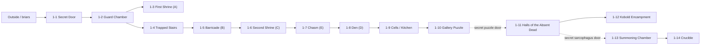

# The Transmuter's Last Touch - Narrative-Only S&S Cut

This version keeps the adventure fiction, old-school dungeon structure, room
keys, named characters, magical premise, clue logic, traps, factions, and map
connectivity. It removes the original game's encounter levels, class levels,
stat blocks, DCs, XP, treasure pricing, tactical assumptions, and system-
specific spell and monster mechanics.

Use this as a Candlelight Dungeons adventure for Sinew & Steel. The module is a
compact dungeon crawl: a kobold war-band has occupied a mountain catacomb whose
old transmutation magic still changes bodies. The danger is not just the
kobolds, but the fact that the dungeon itself remembers a wizard's experiments.

## Adventure at a Glance

- **Premise:** A hidden catacomb under a steep mountainside has become the lair
  of kobolds empowered by strange transmutation hot spots.
- **Inciting hooks:** A raided caravan, a contract to stop attacks, or stolen
  goods taken from the characters' camp.
- **Old magic:** Verdivis, a famed transmuter, once used the catacomb as a
  laboratory.
- **Current threat:** Tazex the Everchanging, a mutated kobold chieftain, wants
  to make the dungeon's temporary augmentations permanent and lead an army of
  transformed kobolds.
- **Complication:** Idruma, Tazex's reluctant consort and spiritual/alchemical
  adviser, dislikes his brutality and may be turned.
- **Final chamber:** The Crucible, Verdivis's old working space, where Tazex's
  own transformation began.

## What to Keep From the Original Module

- The dungeon as a tight sequence of keyed rooms.
- The transmutation hot spots, here treated as **flux zones**.
- Kobolds who know the flux zones and fight through terrain, alarms, ambushes,
  traps, and retreat.
- Soleth's old death-priest catacomb beneath Verdivis's later laboratory.
- Tazex as a frightening, arrogant, physically warped leader.
- Idruma as the social hinge: hostile if threatened, useful if respected.
- The old map's connectivity, represented below as a graph.

## Hooks

### The Ransacked Caravan

The delver finds an overturned caravan wagon, thoroughly looted. Tracks, blood,
dropped goods, and reptilian footprints lead toward a steep wooded hillside.
This is the cleanest Candlelight hook: crime, trail, hidden door.

### The Four-Armed Demon

Local merchants hire the delver to locate the source of recent caravan strikes.
One survivor swears that a demon with four arms led small reptile-men from the
trees. The description is wrong in theology but right in fear.

### Theft in the Night

During camp, kobolds create a noisy distraction while two or three thieves dart
in and steal valuables. Following the trail brings the delver to the hidden
catacomb entrance.

### A Strange Pouch

Near the entrance, a belt pouch lies discarded in the briars. It contains a
polished red-and-gray jasper. This is a small sign of careless kobold glee and
recent traffic.

## Background

Verdivis was a powerful transmuter remembered by bards. Rather than pursue
lichdom, he tried to extend life by correcting the body's limits. Some legends
say he journeyed to another plane. Others say he became something else and left
wizardry behind.

In his youth, after years of adventuring, Verdivis found an unfinished catacomb
in the side of a mountain. The place had been carved by priests of Soleth, a god
of the dead, but the priests abandoned it before completion when grimlocks from
below overran the complex. Verdivis drove the grimlocks out and made the
catacomb his laboratory.

He was not driven by greed so much as amoral fascination. He altered creatures,
merged traits, replaced abilities, and treated living bodies as artful problems.
When he had learned all he wanted from the catacomb, he moved on.

His magic did not leave. Transmutation saturated the walls, air, and old
chambers. Over time the magic pooled into concentrated pockets. Any creature
stepping through one of these flux zones can be altered for a few moments.

Years later, Tazex, an exiled kobold lieutenant, discovered the catacomb. He
stumbled into one of Verdivis's lingering effects and was permanently changed.
With new strength and monstrous traits, he returned to his tribe, challenged the
old chieftain, and left the tribe shattered. He gathered survivors and led them
back to the catacomb, promising that each of them could become stronger.

Now Tazex rules from below. With Idruma, his reluctant consort and adviser, he
studies Verdivis's magic and dreams of making the augmentations permanent. The
kobolds raid caravans to fund and feed the lair. Tazex styles himself "the
Everchanging" and believes the future belongs to him.

Most kobolds follow him from fear and morbid awe. Many liked the old chieftain
better.

## Candlelight Conversion Premise

This is a dungeon about **power borrowed from a place**.

The flux zones are not a new rules subsystem. Treat them as visible, strange
hazards and opportunities. Kobolds know where many zones are and use them
cunningly. Delvers can learn, exploit, fear, or avoid them.

In S&S terms:

- A flux zone triggers when entered unless the delver has learned how to avoid
  or time it.
- The effect usually lasts for one fight, one scene, or a few dangerous beats.
- Learning a zone's nature can be a LOR test when uncertain, but observation,
  experimentation, and kobold behavior should reveal plenty without a roll.
- Repeated voluntary use can tick a **Flux Contamination** clock.
- A natural 20 while experimenting with flux should twist the effect or mark
  Fatigue.
- Tazex cannot benefit from ordinary flux zones anymore; his mutation is already
  deeper than the catacomb's temporary pockets.

## Flux Zones A-L

Use these as narrative effects and S&S levers, not imported templates.

### A. Noisome

The body sweats a greenish vapor. Anyone close enough to breathe it may stagger,
retch, lose nerve, or suffer Disadvantage until they get clear.

S&S use: proximity hazard, Fatigue cost, or a momentary opening in melee.

### B. Fire-Infused

The eyes glow like coals and fire dances in the throat.

S&S use: short cone of flame, igniting oil or dry goods, forcing a DEX defense,
or making a kobold dangerous at close range.

### C. Quickened

Every twitch, blink, and step becomes supernaturally fast.

S&S use: Advantage on speed, dodge, pursuit, or a fast strike. On a bad flux
twist, the subject overcommits or burns Fatigue.

### D. Earth-Infused

The eyes darken and the voice grinds like dry soil.

S&S use: temporary soak, resistance to being moved, or a spray of grit and stone
shards.

### E. Clouded

A gray mist clings to the subject and moves with it.

S&S use: concealment, ambush cover, escape, or Disadvantage for attacks through
the vapor.

### F. Enlarged

The body trembles and swells to human height. Gear grows with it.

S&S use: STR Advantage, reach, intimidating presence, but clumsy movement in
tight passages.

### G. Forceful

Air ripples at the fingertips.

S&S use: invisible shove, thrown enemy, blasted door, or sudden forced movement
into a hazard.

### H. Mucilaginous

Purple slime coats the body and an alchemical stink taints the air.

S&S use: slippery grappling, acid touch, squeezing through gaps, or a disgusting
counter to restraint.

### I. Evanescent

The subject flickers out of sight and back again.

S&S use: partial invisibility, a vanishing feint, or uncertainty about target
position.

### J. Venomous

One finger or appendage curls into a thorn, wet with green poison.

S&S use: a poisoned barb. On serious failure, the victim collapses, sleeps,
marks Fatigue, or loses a scene to fever.

### K. Solidified

The body stiffens into dark stone for a beat, then moves again.

S&S use: momentary invulnerability, blocking a passage, surviving a blow, or
being trapped helplessly in the wrong position.

### L. Vitreous

The body becomes mirrored and glass-hard.

S&S use: dazzling reflections, brittle protection, or a dangerous shattering
death if struck down while transformed.

## Dungeon Features

- The catacomb has ten-foot ceilings unless noted otherwise.
- The masonry is bluish and pocked by tiny craters, altered by magical osmosis.
- Detection and divination are unreliable through the walls.
- Sound is damped by old magic. Loud combat carries nearby, then fades quickly.
- The gong in area 1-2 is the one alarm that reliably reaches Tazex.
- Doors are newer than the catacomb and generally unlocked; Tazex acquired few
  keys.
- Kobolds speak mostly Draconic. Some know fragments of Common: "run,"
  "surrender," and "no kill."
- Kobold courage depends on flux. When one of them is empowered, they are much
  less likely to flee.

## Map as Node-Edge Graph

This graph preserves the flow of the scanned map without reproducing the map
image. It is a play aid, not a tactical grid. Secret passages and puzzle
connections are included because they matter to Delvekit play.

### Edge List

- Outside briars -> 1-1 Secret Door.
- 1-1 -> 1-2 once liquid is poured into the skeletal mouth relief.
- 1-2 -> 1-3 through the west door.
- 1-2 -> 1-4 through the trapped stair route.
- 1-4 -> 1-5.
- 1-5 -> 1-6.
- 1-6 -> 1-7.
- 1-7 -> 1-8.
- 1-8 -> 1-9.
- 1-9 -> 1-10.
- 1-10 -> 1-11 through the statue-head puzzle door.
- 1-11 -> 1-12.
- 1-11 -> 1-13 through the secret sarcophagus door.
- 1-13 -> 1-14.

The map also marks additional flux letters in later rooms and corridors. Use
the visual map if exact placement matters; otherwise treat F-L as available
late-dungeon flux zones that Tazex and his warriors may try to exploit around
areas 1-10 through 1-14.

## Areas of the Catacomb

### 1-1. The Secret Door

At the base of a steep rocky wall, briars and ivy conceal a squared depression
in the stone. Within it stands the outline of a large stone door that looks as
if it has not opened in centuries. There is no handle or ring. Torn vines reveal
intricate bas-reliefs.

The northern door is false. It exists to distract tomb robbers from the true
door on the east wall. The relief provides the clue.

The carved scene shows a robed and hooded figure administering a potion to a
shrouded skeletal corpse on a bier. Behind them waits an open sarcophagus. A
similar hooded figure stands on the left wall. On the right, a life-sized
shrouded skeleton is carved with its arms folded and mouth open in a silent
scream.

The old priests of Soleth purified the dead by administering a draught. To open
the true door, entrants must pour water, a potion, or another liquid into the
carved skeleton's mouth. The eastern wall opens.

S&S guidance:

- Careful inspection finds the false door and the true seam.
- Religious or funerary knowledge explains the rite.
- Brute force should be loud, slow, and likely to alert or exhaust rather than
  simply fail.

### 1-2. The Guard Chamber

Three wooden doors open beneath lofty arches into a broad chamber. Kobolds sit
around a chalk circle playing at bones. They wear piecemeal armor and keep
spears close. Their leader, Ydak, watches with a mace and a scowl.

On the far wall hangs a heavy, dented, dark-gold disk with a padded striker
beside it.

The kobolds' duty is to sound the alarm. The gong is not naturally loud, but it
is a focus for Verdivis's old alarm magic and resonates in areas 1-13 and 1-14,
warning Tazex.

The ceiling is high. Verdivis's personal arcane mark is etched into the north
wall. Anyone who recognizes it learns that the dungeon is tied to a famed
transmuter.

Ydak is out of Tazex's favor and has something to prove. If he falls quickly,
the other kobolds may forget the gong. If any kobold escapes, they run west
toward the Noisome flux in area 1-3.

Story treasure:

- The heavy gilded-bronze gong.
- Chalk and bone dice from the game.
- Ydak's gear, if story-relevant.

### 1-3. The First Shrine

A stone figure seems to step from the wall: a large hooded man in a billowing
cloak, broadsword down, one hand raised as if commanding trespassers to halt.

The statue depicts Soleth, a generally benevolent god of the dead once revered
by the priests who began this catacomb. Here he is a warning: turn back, leave
the dead alone.

Flux A, Noisome, is nearby. Kobolds fleeing the guard chamber may use it before
making a stand or vanishing deeper.

### 1-4. The Trapped Stairs

This passage was already a trap when the catacomb was carved. Halfway down, the
steps sink into a crude ramp and metal hooks spring from the side walls. Anyone
falling slides into the hooks.

The priests of Soleth may have honored peaceful death, but they hated those who
would deny the dead their rest.

S&S guidance:

- Telegraph with odd seams, scrape marks, old blood, missing dust, or the angle
  of the steps.
- Careful probing can jam, bypass, or reveal it.
- A rushed descent can cost Stamina, Fatigue, gear, or position.

### 1-5. The Barricade

Green torchlight flickers from the far side of a tall room divided by a massive
barricade. The smell of unwashed scales grows stronger, and a faint rot hangs
under it.

Tazex ordered this barrier built in case enemies came in force. It is made from
salvaged caravan goods: wheels, doors, furniture, harnesses, crates, and
plunder. Kobolds know the hidden gap near the south wall and the ladders on
their side.

On the far side, kobolds throw daggers at a dead human caravan guard slumped
against the wall. They are bored, cruel, and quick to use Flux B, Fire-Infused,
if they hear intruders.

Story treasure:

- A green-flamed iron torch fixed to the wall.
- Salvage from the dead caravan guard.
- Evidence that Tazex's raids are recent and lethal.

### 1-6. The Second Shrine

Another figure of Soleth emerges from the wall, but this one is harsher. He is
hooded and cloaked, holding a broadsword upright, pointing forward in judgment.
His face is burned down to a stony skull grin.

This is Soleth as judge, a warning against intrusion. Passing before the statue
without prayer or respect triggers an old sleep charm.

Kobolds nearby know the trap and may wait to strike at anyone who collapses.
They use Flux C, Quickened, to become faster and more dangerous.

Story treasure:

- A hidden cache beneath the statue: old holy water, coins, or a healing charm.
- A clue that the catacomb belonged to death-priests before Verdivis.

### 1-7. The Chasm

A chasm opens across the chamber. Damp earth and decay rise from below. Red eyes
watch from the far darkness. The remnants of a broken stone bridge jut from the
edge. A rope-and-board bridge now crosses diagonally.

Below is a slow underground river, narrow and dark. Kobolds who displease Tazex
are thrown into the chasm. Small rungs hidden in one corner allow ascent from
below, but they are easy to miss.

The bridge is sturdier than it looks, but the kobolds have rigged it so they can
drop intruders into the river. A side ledge offers another route, but part of it
has been weakened.

The first kobold to act may use Flux E, Clouded, to hide what they are doing.

Story treasure:

- A dead tomb-robber's ring or relic in the river below.
- A possible water-level route for expansion.

### 1-8. The Den

A side hall opens into shadowy niches holding upright stone sarcophagi without
lids. Animal musk hangs in the air. Something rustles deeper in the gloom.

This is the den of the kobolds' last great pet, an ill-tempered dire weasel.
Flick, its kobold keeper, prefers shadows, distance, and surprise. If he expects
a fight, he urges the animal through Flux D, Earth-Infused.

Story treasure:

- An alchemical silver dagger hidden by a kobold who did not want Tazex to take
  it.

### 1-9. The Cells and Kitchen

Torches light a row of large cells. Prisoners rustle within, and the air smells
of unwashed bodies. Oddly, cooked meat and vegetables smell good nearby.

These cells were meant for enemies of the old church but likely never used
before Tazex. Now the area is both cell block and kitchen.

Idruma stands nearby among shelves, crude kitchenware, and a table of crockery
and half-prepared food. She is Tazex's reluctant consort, healer, alchemist,
spiritual leader, and jailer. She is not cowardly, but she dislikes Tazex's
brutality and recklessness.

Cells:

- **Cell I:** Duzin, a well-fed but terrified goblin. He likes Idruma despite
  their language barrier. He expects to die and will run if he can. If dragged
  along, he may try to win Tazex's mercy by betraying the delver.
- **Cell II:** Empty except for brackish water.
- **Cell III:** Two kobolds imprisoned for questioning Tazex. He has threatened
  to execute one as an example. They are trying to convince Idruma to release
  them.
- **Cell IV:** A scentless corrosive flux cloud. Four human remains lie inside.
  This is where Tazex puts the dying and the unwanted.
- **Cell V:** Open, with a table and two chairs. Tazex dines with Idruma here.

Idruma can become a crucial social encounter. If treated respectfully and shown
that Tazex can be opposed, she may reveal:

- Tazex's broad scheme.
- The existence of a nearby secret door.
- That he studies the flux zones to make the changes permanent.
- That many kobolds fear him.

She will not casually solve the gallery puzzle unless pressed, persuaded,
traded with, or frightened.

Story treasure:

- Food enough to feed many small bodies for a short time.
- A small sanctuary charm hidden among supplies.
- Idruma's cell key and alchemical goods, if she is defeated or bargains them
  away.

### 1-10. The Gallery

A long vaulted chamber holds two rows of solemn stone warriors. Each is slightly
taller than a human, helmeted, cloaked, and carved in armor. Real weapons rest
in their stony hands.

The statues represent an old knightly order allied to the church of Soleth.
Each statue has a number, determined by the sharp points on its weapon:

- West side: longsword (1), scimitar (2), trident (3).
- East side: double-sword (2), spear (1), spiked shield (3).

Each statue's head can rotate. Turning matching numbers to face one another
opens a secret door in the north wall. The door can be opened easily from the
far side, but from here the puzzle is the clean route. The mechanism resets
after a short time.

S&S guidance:

- Do not turn this into a riddle wall. Let observation solve it.
- If the delver experiments logically, let it work.
- If they rush under pressure, use one LOR or DEX test at most.

### 1-11. Halls of the Absent Dead

A pale blue torch burns in a solemn tomb, but its light fails to fill the room.
Rows of alcoves hold upright stone sarcophagi without lids. If the dead were
ever interred here, they are gone. The air is cold, interrupted by strange warm
currents.

If the gong was struck or kobolds escaped, Tazex may have placed warriors in
the shadows here while he watches from the mirror in area 1-13. If the delver
arrives quietly, the hall may be empty, but Tazex notices them now.

Secret doors:

- One hidden behind sarcophagi leads back to the gallery.
- Another leads to the summoning chamber.

Story treasure:

- A blue-flamed torch like the green one from the barricade.
- The eerie emptiness of missing dead, useful as mood and clue.

### 1-12. Kobold Encampment

This vast hall is the main encampment. Animal skins, fur beds, small chests,
trinkets, and household clutter fill the room. Kobold families recoil in fear
while warriors seize weapons.

At the north wall, a great archway once led deeper into the mountain. That was
where the grimlocks came from. Verdivis collapsed the passage long ago to seal
the catacomb from the underdeep.

The warriors defend their weaker kin. The females and young attack only if
provoked. If spared once Tazex's power is broken, they flee the catacomb and
abandon him.

S&S guidance:

- This is not simply a fight room. It is the moral center of the kobold faction.
- A delver can massacre, bargain, frighten, split the faction, or let families
  flee.
- Idruma's defection, Duzin's panic, or punished kobolds from area 1-9 can
  change this scene.

Story treasure:

- The tribe's small kept wealth and personal ornaments.
- Evidence that Tazex hoards the real plunder for himself.

### 1-13. The Summoning Chamber

A tarnished bronze statue of a robed man stands in one corner. A huge glass
cube floats ten feet above the floor, bottom face missing. On the east wall, a
gold-framed mirror shows the halls of empty sarcophagi rather than the room.
Runes cover the stone walls.

The mirror is a stoneglass device that lets the viewer look through stone like
a window. Tazex has used it to watch the Halls of the Absent Dead.

The bronze statue resembles Verdivis. It was once a servitor golem, stripped of
power when he left. Lingering magic has given it a mindless echo of life. If
fighting breaks out here or in the Crucible, it lurches into motion and attacks
nearby combatants without loyalty. It may strike delvers, kobolds, or Tazex.
When fighting stops, it returns to stillness.

The glass cube is an old creature-cage. If a living creature moves beneath it,
the cube drops, traps the target without crushing them, then rises again after a
few beats. Treat it as a containment hazard, not damage.

Story treasure:

- The stoneglass mirror, valuable and difficult to move.
- The bronze statue, too heavy and dangerous to treat as simple loot.
- Conjuration runes now empty of power but useful for lore.

### 1-14. The Crucible

Lurid purple light stains the walls deep crimson. The air undulates with magic,
slow as underwater currents. The light comes from a raised dais reached by
short steps.

This was Verdivis's main workspace, the crucible of his art. When Tazex first
stepped onto the dais, accumulated power changed him. The dais is now mostly
spent, except for its purple glow and lingering unease.

If Tazex waits here, frame him like this:

Tazex stands with the confidence of an imperious archmage, but he barely
resembles his kin. He is taller, muscled, and wrong. His tail has split into
three writhing appendages. His torso carries a second pair of furred arms,
ending in razor claws. In his main reptilian hands he grips a blood-dark axe.

"Tazex the Everchanging greets you," he hisses.

Tazex is arrogant, not foolish. If badly outnumbered or outmatched, he uses his
strange mutation to slip away, lure pursuit, and fight where the catacomb helps
him. If his kobolds still live, he rallies them around the flux zones. Without
them, he is more cautious.

Tazex's hoard lies near the dais: caravan wealth, gemstones, weapons, alchemy,
scrolls, curios, and trophies. In Candlelight terms, keep only the treasure that
changes play: stolen goods that can be returned, the music box, the hourglass,
weapons with history, and evidence of the raids.

## Conclusion

If Tazex dies or is driven off, most remaining kobolds flee. Idruma may stay
long enough to speak if the delver earned her trust. Freed from Tazex, she
knows a great deal about the catacomb, the flux zones, his ambitions, and the
tribe's fear.

The stolen valuables came from multiple caravans. Their original owners are
hard to identify, but a delver who makes a real effort to return some goods
earns future trust, rumors, and patronage.

If Tazex escapes, he becomes a recurring threat. His mutation continues. He
gains new monstrous features, new ways to survive, and a more personal hatred
of the delver. He will not underestimate them twice.

## Named Cast

### Verdivis

Legendary transmuter and former master of the catacomb. Amoral, brilliant, and
obsessed with bodily possibility. Gone from the dungeon, but still present in
its magic.

### Tazex the Everchanging

Mutated kobold chieftain, exiled lieutenant, conqueror of his old tribe, and
would-be maker of transformed armies. Arrogant, theatrical, and dangerous. His
followers fear him more than they love him.

### Idruma

Kobold adept, healer, alchemist, spiritual adviser, jailer, and Tazex's
reluctant consort. She believes Tazex is reckless and brutal. She is the best
chance to turn the dungeon from pure slaughter into faction play.

### Ydak

Elite kobold in the guard chamber, currently out of Tazex's favor. He wants to
prove himself and get the gong sounded.

### Flick

Kobold ranger and keeper of the dire weasel. He favors shadows, distance, and
letting the beast do the ugly work.

### Duzin

Scared goblin prisoner in the cells. Well fed by Idruma but convinced he is
doomed. He may run, betray, plead, or become a useful witness.

### Soleth

Old god of the dead, honored by the priests who began the catacomb. His statues
and rites guard the entrance and several interior thresholds.

## Clue Index

### Verdivis's Mark

The arcane mark in area 1-2 identifies the dungeon's connection to a famous
transmuter.

### Flux Behavior

Kobolds stepping deliberately into odd spaces, then changing, teaches the
delver how the catacomb works.

### Soleth's Rite

The entrance relief teaches the first puzzle: give liquid to the dead to open
the way.

### Empty Tombs

The missing dead in the Halls of the Absent Dead suggest the catacomb was never
completed or was emptied by later horrors.

### Idruma's Doubt

Idruma's treatment of prisoners and reluctance to fight reveal a fracture in
Tazex's rule.

### Punished Kobolds

The prisoners in Cell III show that not all kobolds support Tazex.

### Stoneglass Mirror

The mirror explains why Tazex may know the delver's movements even when sound
does not carry.

### Crucible Dais

The purple dais explains Tazex's permanent transformation and why he cannot use
ordinary flux zones.

## Sinew & Steel Conversion Notes

- Run this as a **medium Candlelight Delvekit** dungeon by default. Use hard
  mode if you want the old-school bite to be sharp; use soft mode if the focus
  is on exploration and strange magic.
- Keep combat fast. Lesser kobolds are dangerous because they exploit terrain,
  traps, numbers, alarms, and flux, not because they need detailed statistics.
- Give every flux zone a sensory tell: heat shimmer, ozone, glassy dust, green
  vapor, humming floor, slick wall, or hair rising.
- Let clever players learn flux through observation. Do not require every
  interaction to be a roll.
- Use **Fatigue** for bad trap outcomes, frantic chases, flux backlash, poison,
  corrosive gas, chasm falls, and repeated voluntary augmentation.
- Track **Tazex Alerted** as a clock. The gong, fleeing kobolds, noisy failures,
  and use of the mirror advance it.
- Track **Flux Contamination** if a delver repeatedly uses augmentations. At
  low ticks, it is strange dreams and temporary marks. At high ticks, it becomes
  a Tazex-shaped temptation.
- Treat Idruma, the punished kobolds, and the encampment families as faction
  pressure. The dungeon should not collapse into automatic extermination unless
  that is the delver's choice.
- The final confrontation is stronger if Tazex can flee, reposition, and force
  the delver to decide whether to chase, rescue captives, loot, or break his
  hold on the tribe.
- Story treasure matters most: the green and blue torches, stoneglass mirror,
  Verdivis lore, the music box, the hourglass, stolen caravan goods, and any
  proof that Tazex's raids caused harm.

## Scan and OCR Notes

This cleaned file was produced from a comparison of the available scan
variants:

- Brother direct text was the best working backbone for reading order.
- Brother OCR PDF was useful but opendataloader's Markdown pass inherited
  two-column ordering problems and glued many words together.
- Image-only PDF contained no extractable text until external OCR was added.
- OCRmyPDF/Tesseract produced useful text from the image scan, but took longer
  and still produced scan artifacts.

Recommendation for future scanned modules: save both the OCR PDF and the direct
OCR text, and keep the image PDF when maps or art matter. For this workflow, the
direct text is fastest for narrative cleanup, the OCR PDF is useful for
opendataloader and page-level reference, and the image/PDF scan is essential for
maps.
